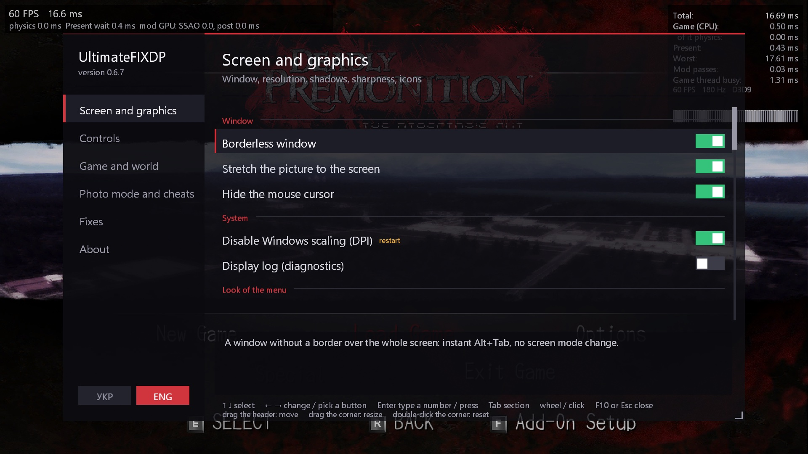
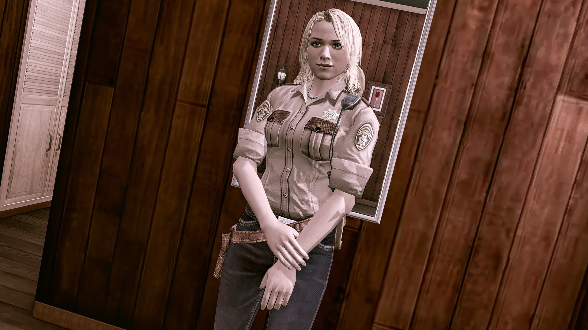

<div align="center">


# UltimateFIXDP

**The all-in-one fix for _Deadly Premonition: The Director's Cut_**
<br>
_Універсальний фікс для_ **Deadly Premonition: The Director's Cut**

[](https://github.com/LittleBitUA/UltimateFIXDP/releases)
[](https://github.com/LittleBitUA/UltimateFIXDP/releases)
[](https://ultimatefixdp.github.io/)
[](LICENSE)
[](https://store.steampowered.com/app/247660/)
[](https://t.me/LittleBitUA)





</div>

---

## 🇬🇧 In English

One DLL in the game folder instead of DPfix, a stability fix, a map fix and a crash fix.
No installer: press **F10** in game and everything is there. The mod also gives the game 4 GB of memory by itself (from the second start).

> **Version 0.7.15.** Most features are tested in game, the rest are marked _experimental_. Back up `savedata\dp.sav` first.
> <br>Newest: a posed character next to York in the photo mode, play as other characters, a spawner for cars and items, a partner on the gamepad and a first mission editor — see [What's new](#whats-new-in-0713). Earlier versions: [CHANGELOG.md](CHANGELOG.md).

### Features

#### Stability and speed

- 🛡️ **Stability** — the crash after cutscenes, the zero-frame-time freeze and the Alt+Tab hang are fixed; a crash handler and a freeze watchdog write a dump if anything still goes wrong
- 🚀 **Low FPS fixed** — on some PCs the game sat at ~45 FPS with an idle GPU; **45 → 180 FPS** in our test
- ⏱️ **60 FPS limit at any refresh rate** — at 144 / 180 Hz the game used to run too fast
- 🏎️ **High FPS physics** — 120–180 FPS with the car, doors, animations and timers at their normal speed; the FPS is unlocked by default
- 💾 **Safe saves** — atomic writes, 60 backups named by episode, chapter and play time, automatic restore of a damaged `dp.sav`

#### Picture

- 🖥️ **Real output resolution** — the picture and the HUD at your monitor's resolution instead of 1280×720, borderless window, no DPI blur
- ✨ **Graphics** — supersampling 1×–3×, horizon-based ambient occlusion (HBAO), SMAA and FXAA, adaptive sharpening (AMD RCAS), wet reflections, 16× anisotropic filtering, sharper shadows, longer draw distance
- 📺 **Xbox 360 look** — the console's colour grading and TV gamma on top of the PC picture
- 🌫️ **No more flickering far textures** — the game's camera wasted depth precision; far roads, roofs and decals no longer fight each other
- 🌊 **The river has water again** — ripples, glints and reflection as on the Xbox 360 instead of a flat blue strip (in its scene by default, everywhere if you choose)

#### Controls and camera

- 🎮 **DualSense** — USB and Bluetooth without Steam Input, **adaptive triggers per weapon and for the car** (gas on R2, brake on L2, each trigger tuned on its own), haptics for driving and shooting, PlayStation button icons
- 📳 **Rumble that works** — the PC port calculated vibration and never sent it to the gamepad
- 🔫 **Aim on L2, shoot on R2** — like a modern shooter, on Xbox pads too; prompts switch between keyboard and gamepad by themselves
- 🖱️ **Camera** — field of view in play, Xbox 360 quick turn, mouse sensitivity and inversion per axis

#### Map, story and residents

- 🗺️ **Full pause map** — all 64 tiles, proper zoom, north up
- 📍 **Waypoints** — F7 sets a mark; the distance in the game's own font and the game's own arrows on the minimap (_arrows are experimental_)
- 📖 **Story and residents** — where the story stands and where to go next, side quests, and the timetable of every resident of Greenvale

#### Photo mode

- 📷 **Camera and picture** — free camera, frozen time, 13 filters with grain, sepia, aberration and letterbox, your own presets, FOV and roll, PNG screenshots with or without the HUD
- 🧍 **A character next to York** — any of Greenvale's 49 residents put into the scene as a still figure: moved and turned by hand, with its own body motion and facial expression; never in a save
- 🎭 **York as you want him** — moved, raised and turned from where he stood; any body motion held on a frame or played; the face composed from named parts (emotion, brows, lids, mouth); all 30 suits in one row, worn as you scroll

#### Cheats, spawner and a partner

- 🧰 **Cheats** — money, time of day, weather, ammunition, god mode, York flies (F3)
- 👥 **Play as** another of the game's own playable characters, with its model and motions, in free play
- 🚗 **Spawner** — any of the game's 16 cars by name in front of York; any item by number and name
- 🎮 **A partner on the gamepad** (_experimental_) — a first try at local co-op: a second character walks by the gamepad while York keeps the keyboard and mouse

#### Mission editor

- 📝 **Mission editor** (_experimental, a first version_) — a mission of your own from the F10 menu: a character, its lines, a choice of two answers, an item, a start banner. The texts live in a plain file you can share; the talk runs in the game's own dialogue mode with your text in the game's own font. Needs `[Debug] MissionLab=1` for now

#### Mods, updates and tools

- 🧩 **Mod manager** — `UltimateFix\mods\<mod>\`: translations (SWERY Localization Tool files), texture packs, or any game file by its name (`fontwide.xpc`, `mes_all.mes`); order and on/off in F10, each mod with its picture and description — see [Making a mod](#making-a-mod)
- 🔄 **Updates itself** — a new version is offered on the start card; F9 downloads it, replaces the files and restarts the game
- 📊 **Tools** — frame statistics panel, built-in profiler, crash dumps and a readable log for support
- 🇺🇦🇬🇧 **Two languages** — Ukrainian and English, switched in the menu

### Engine fixes (RE-based)

Every fix below comes from reverse engineering the game and comparing the PC
port with the Xbox 360 original:

- 🕒 **The "only a reboot helps" slowdown** — the game counted time from
  the Windows uptime counter in single-precision x87 floats, so after days
  without a reboot the frame time lost precision. The mod hands the game a
  counter that starts with the game.
- 🎯 **The 45 FPS mystery** — the game asks Windows about a WinMM gamepad on
  every frame, even with none connected, and on some systems that call takes
  milliseconds. Found with the mod's own profiler; a missing pad is now asked
  about on a background thread, so the game never waits for that answer.
- 🌗 **Day and night inside buildings** — the port reads the building list
  (`HOUSE_LIST`) with a wrong byte-order key: 64 of its 81 entries were misread, so
  interiors had the wrong lighting.
- 💥 **The crash after cutscenes** — an NPC told to walk to waypoint `-1`
  read the navigation table out of bounds. Guarded at the lookup.
- ➗ **The zero-delta freeze** — a frame with zero time divided by zero and
  spun forever. Guarded.
- 🎚️ **Difficulty** — the PC port skips the difficulty screen and stays on
  Easy forever. Normal is the default again, and the choice is yours.
- 📳 **Vibration** — the same event-to-rumble table as on Xbox 360, but the
  PC port never sends it to the device. Restored.
- 🚧 **Draw distance** — booths and vending machines vanished 500 units
  away because of a far plane the Xbox version does not have.
- 🌫️ **Flickering far away** — the play camera's near plane sits at 1.0, so
  the 24-bit depth buffer had almost no precision left in the distance. The
  mod moves it to 20.0: far surfaces stop fighting each other.
- ⚙️ **Above 120 FPS** — 80 timers of the game turned the frame time into
  whole ticks, so above 120 FPS they stood still or ran double. They now share
  whole steps.
- 🧮 **Angles that are not a number** — the angle normalisation hangs the game
  for good on a NaN (`jmp $`). It now returns 0 and logs the caller.
- 🧵 **Why "Windows 98 compatibility mode" helped** — two worker threads of the
  game share data with the main thread without any lock: the world builder
  works while the next frame already updates, and a level change clears the
  residents while the route thread still writes a path into one of them (memory
  damage, or a resident who waits for a route forever). One CPU core hid both.
  The mod makes them wait for each other instead, at full speed.
- 🕹️ **The QTE at high FPS** — the stick-waggle QTE multiplied the stick travel
  by the frame time, so at 180 FPS every A↔D swap counted a third and the QTE
  ran out of time. A swap now counts as at 60 FPS.
- 🧠 **2 GB of memory** — the game is 32-bit and sees only 2 GB; a big render
  scale runs it out. The mod gives `DP.exe` the 4 GB flag by itself (from the
  next start, the original kept as `DP.exe.bak`).
- 🧍 **Residents walking into nowhere** — a failed route lookup moved the
  resident to (0, 0, 0); now the resident stays where it stood.
- 🧰 **"Cannot take items from the toolbox" and the frozen side missions
  list** — a panel that opens starts at zero opacity, and a frame of zero
  length (days of Windows uptime, hundreds of FPS) left it there: the game
  took it for closed. The toolbox fell back to the WEAPONS/ITEMS choice, the
  side missions list and the map's mission view hung on an empty screen. The
  panel now waits for the next frame (`[Fixes] ZeroFrameMenus`; not yet checked
  in the game, `[Debug] ForceZeroFrame` reproduces the bug).
- 🌊 **The river that was a flat blue strip** (0.7.10) —
  on the Xbox 360 the river is grey-teal, covered with moving ripples and
  glints. On PC it is a smooth blue ribbon, as if the water were missing.
  The water itself is there, two things are lost on the way to the screen:
  - **The river's own settings are never applied.** The game's water table
    has an entry named `_river`: reflection 100 %, weight 100 %. The PC port
    draws the river with the values of an object that has no entry at all:
    reflection 0. The game's water shader multiplies the reflection, the
    lighting of the waves and the glints by that number, so all three come
    out as zero and only the river's 4×4 one-colour texture is left. The mod
    hands the river's draws the values of the `_river` entry. Why the port
    does not find the entry by itself is not known yet.
  - **The waves are smaller than a pixel.** The Xbox 360 renders a wave
    texture for each water object; the PC port replaced that with one wave
    map shared by all water, and on the river it repeats so often that the
    waves turn into white noise. The mod draws it 16 times larger. That
    number was picked by eye against Xbox 360 footage, the console's own
    value has not been measured.

  `[Fixes] RiverWater`: 0 off, 1 always, 2 only in the scene by the river (the
  default since 0.7.11); switched in the F10 menu at once.
  Checked in the game at the river; other water (the lake, puddles,
  interiors) has not been compared yet.

### What's new in 0.7.15

**Driving on the triggers.** Behind the wheel the gas is on R2 / RT and the brake (and reverse, when the car stands) on L2 / LT, as on the console. The car's other buttons stay where the game has them. On by default; the row "Gas on R2, brake on L2 in the car" on the Controls page (`[Input] TriggerDrive`) puts the game's layout back (brake L1, gas R1) at once. Checked in the game.

**DualSense adaptive triggers in the car, each on its own.** A group "Triggers in the car (DualSense)" on the Controls page with three rows for the gas trigger and three for the brake:
- **Effect:** off, resistance, a click (a wall that gives way) or vibration.
- **Strength**, 0–100 %.
- **Where it begins** along the trigger's travel, 0 (at once) to 8 (near the end).

The effect stays while the F10 menu is open, so you can tune it on the road: change a row, press the trigger. By default both triggers push back (gas 30 %, brake 60 %). It needs "DualSense adaptive triggers" on and Steam Input off for the game. Checked in the game.

### What's new in 0.7.14

**An important fix: missing buildings and a freeze while driving.** If Greenvale had no buildings at all, or the game froze while you drove through it, this was the mod's own fault, in every version from 0.7.1 to 0.7.13.
- **What went wrong.** The fix "Game threads in turn (world)" (`[Fixes] SerialSetThread`, on by default) woke the game's thread that builds the objects of the open world and at once took away its sign to work. Buildings were built only when that thread happened to run first, which depends on the processor and the load: fine on most computers, never on some. The requests piled up, and when all 4096 places of the game's queue were taken, the game froze for good.
- **What changed.** The thread now keeps its sign until it has finished its turn (one millisecond, as in the game itself). Checked in the game on the save a player sent: the buildings are back, the queue stays empty, the frame rate is the same.
- **If you switched the fix off** to get your buildings back, you can switch it on again (F10 → Fixes → "Game threads in turn (world)").
- A line `world build: …` goes to `ufx.log` if that queue ever grows again.

**The photo mode in a window of its own** (_not yet checked in the game_). The photo key (F6) or "Open the photo mode" on the cheats page opens a window with five sections in place of the menu's own: camera and picture, picture look, suits, motions, spawner. Every section has "Back to the menu".

**For finding faults:** `[Debug] Bisect` in `UltimateFix.ini` leaves groups of the mod's hooks out for one run (the numbers are in the source, `main.cpp`). This is how the fault above was narrowed down.

Earlier versions: [CHANGELOG.md](CHANGELOG.md).

### Screenshots

<table>
<tr>
<td></td>
<td></td>
</tr>
<tr>
<td></td>
<td></td>
</tr>
</table>

### Standing on the shoulders of

The code is our own (MIT). The ideas, facts and addresses came from earlier community work:

| Project | Author | What we learned from it |
|---|---|---|
| **[ZachFix](https://github.com/h714je/ZachFix)** | h714je | Research of the port, many ideas |
| **[DPfix](https://github.com/PeterTh/dpfix)** | Peter "Durante" Thoman | Resolution, shadows, texture replacement |
| **[DPStabilityFix](https://github.com/Cesario67/DeadlyPremonitionFix)** | Cesario67 | Saves, timing, DualSense layout |
| **[CrashFix](https://github.com/Behelit09/DeadlyPremonition-CrashFix)** · **[MapFix](https://github.com/Behelit09/Deadly-Premonition-The-Director-s-Cut-MapFix)** · **[FreeCam](https://github.com/Behelit09/DeadlyPremonition-FreeCam)** | Behelit09 | Navigation crash, the full map, free camera |
| **[DPRecomp](https://github.com/LittleBitUA/DPRecomp)** | «Little Bit» | Our Xbox 360 recompilation: the reference the PC port is compared with |
| **[Kenney Input Prompts](https://kenney.nl/assets/input-prompts)** | Kenney | Gamepad button icons (CC0) |
| **[AMD FidelityFX FSR 1](https://github.com/GPUOpen-Effects/FidelityFX-FSR)** | AMD | The RCAS formula of the adaptive sharpening, written in our own HLSL (MIT) |

🧪 **Testers:** **Gold flin**, **Tree Fan** and **EliParker**. Thank you for playing the unfinished builds and reporting everything that broke.

### 🤖 Who did what: Claude and Dmytro

Someone wrote to us: *"Claude, fix Deadly Premonition, make no mistakes."* So here it is, honestly.

**Claude** (Anthropic's AI model, working in Claude Code):
- wrote the mod's code: the patches and assembly stubs, the F10 menu, the updater, the checks that compare every patch with the real `DP.exe`. Every commit in this repository is co-authored by Claude;
- read the decompiled game code and the bytes of `DP.exe`, looked for the causes of the bugs and the addresses to fix them at, and carried ideas from the projects above over into our own code;
- wrote the README, the release notes and the website, and packed the test builds and the releases;
- **cannot run the game.** Claude has never seen a frame of it live: everything was written blind, from code, logs and screenshots;
- **made mistakes.** A test build with the wrong DLL inside, a key that clashed with another feature, fixes that took several tries. A person caught each of them in game.

**Dmytro Bidlov** («Little Bit»):
- came up with the project and decides what it is: what gets fixed first, what goes in and what is cut, the MIT license, the rule "our own code only", how the menu and the site look;
- played every test build on Windows and sent back logs, screenshots, saves and shader dumps. Without that, nobody would know that any of this works;
- made [DPRecomp](https://github.com/LittleBitUA/DPRecomp), the Xbox 360 recompilation the PC port is compared with, and the SWERY Localization Tool, and is making the Ukrainian translation this mod was built to carry;
- decides on every release; nothing is published without a check.

What we hold to: *"tested in game"* in this README means a person tested it in game. Everything else is marked _experimental_.

### Installation

1. Back up `savedata\dp.sav`
2. Download the latest version from [Releases](https://github.com/LittleBitUA/UltimateFIXDP/releases)
3. Copy `X3DAudio1_7.dll` and the `UltimateFix` folder into the game folder (next to `DP.exe`)
4. Start the game and press **F10**

> **Requirements:** the Steam version 1.01b of the game. Other builds are detected and the mod stays inactive.
> <br>**DualSense:** turn off Steam Input for the game (Properties → Controller).
> <br>**Do not combine** with DPfix, ZachFix or DPStabilityFix: UltimateFIXDP replaces them.
> <br>**Coming from DP1 Launcher?** This is its successor: remove DPfix (`d3d9.dll`, `DPfix.ini`) first.
> <br>**Linux / Steam Deck (Proton):** players report it works, the F10 menu included. Use **GE-Proton**: with Valve's Proton the game's videos do not play (a matter of the game under Proton, not of the mod). If F10 does nothing, add to the game's launch options: `WINEDLLOVERRIDES="x3daudio1_7=n,b" %command%`.

The release archive holds only the mod: `X3DAudio1_7.dll`, the `UltimateFix` folder and a short `README_UA.txt`. The source code is this repository. Newer versions: the mod asks GitHub at the start and offers **F9** to update itself (`[Menu] CheckUpdates=0` turns that off).

To uninstall, delete `X3DAudio1_7.dll` (and, for the 4 GB flag, put `DP.exe.bak` back as `DP.exe` or let Steam verify the files).

### Keys

| Key | Action |
|---|---|
| **F10** | Settings menu |
| **View + Menu** (DualSense: **Create + Options**) | Settings menu on a gamepad: the D-pad or left stick moves, A / Cross picks, B / Circle closes, LB / RB the section, LT / RT a screen of rows, Y / Triangle the default, R3 the whole description, X / Square a mod's folder on the Mods page, elsewhere the restart while settings wait for one, L3 held on the photo mode page the picture without the menu (`[Menu] PadControl`) |
| **F7** | Set a waypoint (on the pause map or in the world) · **Shift+F7** removes it · **Ctrl+F7** to the game's objective |
| **Shift+S** | Quick turn (on a pad: the Xbox 360 combination) |
| **F6** | Photo mode |
| **F5** / **F4** | Free camera only / hide the HUD in photo mode |
| **F11** | Screenshot (PNG, without the menu) |
| **F9** | Profiler (writes a profile to the log) |

### Making a mod

A mod is a folder in `UltimateFix\mods\` (next to `DP.exe`). F10 → Mods lists every mod with its picture, name, version and author; the selected one gets a card with the picture at 350×350 (at 1080p), what the mod brings and its whole description. What a mod folder can hold:

| File or folder | What it is |
|---|---|
| `text\` | a translation: `mes_all.json` and `glyphmap.json` of the SWERY Localization Tool, `*.txt` corrections |
| `textures\` | texture replacements `<hash>.dds` or `.png` (the hashes come from `[Debug] DumpTextures=1`) |
| game files | right in the folder by their name (`fontwide.xpc`, `mes_all.mes`, `FONTWIDE.DDS` for the picture inside an XPC) or by the game's path (`UPDATA\...`) |
| `mod.txt` | `Name: …`, `Author: …`, `Version: …`, `Description: …` (or `mod.ini`, `info.txt`; the Ukrainian keys work too); `\n` in the description starts a new line |
| `description.txt` | a longer description: the whole text of the file with its line breaks, up to 1023 characters (or `опис.txt`; UTF-8, UTF-16 or ANSI); it wins over `Description:` |
| `cover.png` | the mod's picture: a square, **350×350** recommended, PNG or JPG (`cover.jpg`, `preview.png`, `preview.jpg`, `image.png` work too); a picture that is not square is cropped to its middle |

**A picture and a description, step by step:**
1. Make a square picture, **350×350 pixels** (bigger works too: the mod scales it down; a picture that is not square is cropped to its middle, never stretched). PNG or JPG; a PNG may have transparency. The corners are rounded by the menu, so draw the picture with square corners.
2. Name it `cover.png` (or `cover.jpg`) and put it right in the mod's folder, next to `mod.txt`, not in `textures\`.
3. Write `mod.txt` (UTF-8):
   ```
   Name: Ukrainian translation
   Author: Little Bit
   Version: 1.2
   Description: The whole game in Ukrainian.\nMenus, letters and subtitles included.
   ```
   For a longer text with paragraphs, put it in `description.txt` instead (it wins over `Description:`; up to 1023 characters).
4. Restart the game: the mods are read at start. F10 → Mods shows the picture in the list and at 350×350 in the card (at 1080p; smaller on a smaller window). The log says `mods: <folder>: cover cover.png found`.

None of these files is ever taken for a game file. For example:

```
UltimateFix\mods\Ukrainian\
  mod.txt            Name: Ukrainian translation / Author: Little Bit / Version: 1.0
  description.txt
  cover.png          350×350
  text\mes_all.json
  text\glyphmap.json
```

### If something goes wrong

- `UltimateFix\ufx.log` says for every fix whether it is active or skipped, and why
- Every feature can be switched off in F10 or in `UltimateFix.ini`; `[Debug] SafeMode=1` starts with fewer hooks
- Report problems with `ufx.log` and the `crash_*.dmp` / `hang_*.dmp` file, if there is one
- After an update, an old `UltimateFix.ini` keeps old values (a few old defaults are updated by the mod itself): delete it to get all the new defaults

### Development

```bash
make                                  # build/X3DAudio1_7.dll
make test DPEXE=/path/to/DP.exe       # checks every patch site against a real DP.exe
```

Stack: **freestanding C++17** (mingw-w64 i686, no C runtime; imports only `kernel32`, `user32`, `gdi32`),
a proxy `X3DAudio1_7.dll` that passes audio calls on to the real library and patches the game in memory.
Every patch checks the game's bytes first: if they differ, only that patch switches itself off.

---

## 🇺🇦 Українською

Одна DLL у теці гри замість DPfix, фіксу стабільності, фіксу мапи й фіксу вильотів.
Без інсталятора: натисніть **F10** у грі, і все там. Мод також сам дає грі 4 ГБ пам'яті (з другого запуску).

> **Версія 0.7.15.** Більшість функцій перевірено в грі, решту позначено як _експериментальні_. Спершу зробіть копію `savedata\dp.sav`.
> <br>Найновіше: персонаж поруч із Йорком у фоторежимі, гра за інших персонажів, спавнер машин і предметів, напарник із ґеймпада і перший редактор місій — див. [Що нового](#що-нового-в-0713). Попередні версії: [CHANGELOG_UA.md](CHANGELOG_UA.md).

### Можливості

#### Стабільність і швидкість

- 🛡️ **Стабільність** — виправлено виліт після катсцен, зависання на нульовому кадрі й зависання після Alt+Tab; обробник вильотів і сторож зависань пишуть дамп, якщо щось усе ж трапиться
- 🚀 **Виправлено низький FPS** — на деяких ПК гра трималась на ~45 FPS при вільній відеокарті; у нашому тесті **45 → 180 FPS**
- ⏱️ **Ліміт 60 FPS на будь-якій частоті екрана** — на 144 / 180 Гц гра раніше бігла надто швидко
- 🏎️ **Фізика на високому FPS** — 120–180 FPS, а машина, двері, анімації й таймери йдуть з нормальною швидкістю; FPS типово розблоковано
- 💾 **Надійні збереження** — атомарний запис, 60 резервних копій із підписом (епізод, розділ, час гри), автоматичне відновлення пошкодженого `dp.sav`

#### Картинка

- 🖥️ **Справжня вихідна роздільність** — картинка й HUD у роздільності монітора, а не 1280×720, вікно без рамки, без розмиття від масштабування Windows
- ✨ **Графіка** — суперсемплінг 1×–3×, затінення по горизонту (HBAO), SMAA і FXAA, адаптивна різкість (AMD RCAS), мокрі відбиття, анізотропна фільтрація 16×, чіткіші тіні, більша дальність промальовки
- 📺 **Вигляд Xbox 360** — кольорокорекція й гамма телевізора консолі поверх картинки PC
- 🌫️ **Далекі текстури більше не блимають** — камера гри марнувала точність глибини; далекі дороги, дахи й написи більше не «перебивають» одне одного
- 🌊 **У річці знову є вода** — брижі, відблиски й відбиття, як на Xbox 360, замість пласкої синьої смуги (типово у своїй сцені, за бажанням усюди)

#### Керування й камера

- 🎮 **DualSense** — USB і Bluetooth без Steam Input, **адаптивні триґери під кожну зброю й для машини** (газ на R2, гальмо на L2, кожен триґер налаштовується окремо), відгук у машині й при пострілах, іконки кнопок PlayStation
- 📳 **Вібрація, яка працює** — PC-порт рахував її, але не надсилав на ґеймпад
- 🔫 **Приціл на L2, постріл на R2** — як у сучасних шутерах, і на Xbox-падах; підказки самі перемикаються між клавіатурою й ґеймпадом
- 🖱️ **Камера** — кут огляду в грі, швидкий розворот як на Xbox 360, чутливість миші й інверсія по кожній осі

#### Мапа, сюжет і жителі

- 🗺️ **Повна мапа паузи** — усі 64 плитки, нормальний масштаб, північ угорі
- 📍 **Мітки** — F7 ставить мітку; відстань ігровим шрифтом і рідні стрілки гри на мінімапі (_стрілки експериментальні_)
- 📖 **Сюжет і жителі** — де ви в сюжеті й куди йти далі, побічні завдання і розклад кожного жителя Ґрінвейла

#### Фоторежим

- 📷 **Камера і картинка** — вільна камера, заморожений час, 13 фільтрів із зерном, сепією, аберацією та кінорамкою, власні пресети, кут огляду й нахил, знімки PNG з інтерфейсом або без
- 🧍 **Персонаж поруч із Йорком** — будь-хто з 49 жителів Грінвейла у сцені як нерухома фігура: пересувається й повертається вручну, має власну анімацію тіла й міміку; у збереження не потрапляє
- 🎭 **Йорк, яким ви його хочете** — зсунутий, піднятий і повернутий від місця, де стояв; будь-яка анімація тіла на вибраному кадрі або в русі; обличчя з названих частин (емоція, брови, повіки, рот); усі 30 костюмів в одному рядку, одягаються під час гортання

#### Читкоди, спавнер і напарник

- 🧰 **Читкоди** — гроші, час доби, погода, набої, невразливість, політ Йорка (F3)
- 👥 **Грати за** іншого персонажа, за якого гра сама дає грати, з його моделлю й анімаціями, у вільній грі
- 🚗 **Спавнер** — будь-яка з 16 машин гри за назвою перед Йорком; будь-який предмет за номером і назвою
- 🎮 **Напарник із ґеймпада** (_експериментально_) — перша проба локального кооперативу: другий персонаж ходить за ґеймпадом, а Йорк лишається на клавіатурі й миші

#### Редактор місій

- 📝 **Редактор місій** (_експериментально, перша версія_) — власна місія з меню F10: персонаж, його репліки, вибір із двох відповідей, предмет, банер початку. Тексти лежать у звичайному файлі, яким можна ділитися; розмова йде у власному режимі діалогу гри, вашим текстом і шрифтом гри. Поки що потрібен `[Debug] MissionLab=1`

#### Моди, оновлення й інструменти

- 🧩 **Менеджер модів** — `UltimateFix\mods\<мод>\`: переклади (файли SWERY Localization Tool), текстурні паки або будь-який файл гри за іменем (`fontwide.xpc`, `mes_all.mes`); порядок і вмикання в F10, кожен мод зі своєю картинкою й описом — див. [Як зробити мод](#як-зробити-мод)
- 🔄 **Оновлюється сам** — нову версію мод пропонує на стартовій плашці; F9 завантажує її, замінює файли й перезапускає гру
- 📊 **Інструменти** — панель статистики кадрів, вбудований профайлер, дампи крашів і зрозумілий журнал для підтримки
- 🇺🇦🇬🇧 **Дві мови** — українська та англійська, перемикаються в меню

### Виправлення рушія (на основі reverse engineering)

Кожне виправлення нижче — результат розбору коду гри й порівняння PC-порту
з оригіналом для Xbox 360:

- 🕒 **Гальмування, яке лікувалось лише перезавантаженням ПК** — гра
  рахувала час від лічильника роботи Windows у x87 float одинарної точності,
  тож після кількох днів без перезавантаження час кадру втрачав точність.
  Мод дає грі лічильник, який починається разом із нею.
- 🎯 **Загадка 45 FPS** — гра щокадру питає Windows про ґеймпад WinMM,
  навіть коли його немає, а на деяких системах цей виклик триває мілісекунди.
  Знайдено вбудованим профайлером мода; тепер про відсутній ґеймпад питає
  фоновий потік, і гра на цю відповідь не чекає.
- 🌗 **День і ніч у будівлях** — порт читає список будівель (`HOUSE_LIST`)
  з неправильним ключем порядку байтів: 64 з 81 записів читались хибно, тож
  у приміщеннях було не те освітлення.
- 💥 **Виліт після катсцен** — NPC, якого відправили до точки `-1`, читав
  таблицю навігації поза її межами. Тепер там стоїть перевірка.
- ➗ **Зависання на нульовому кадрі** — кадр із нульовим часом ділив на нуль
  і крутився вічно. Тепер там стоїть перевірка.
- 🎚️ **Складність** — PC-порт пропускає екран вибору складності й назавжди
  лишає легку. Звичайна знову типова, і вибір за вами.
- 📳 **Вібрація** — та сама таблиця «подія → вібрація», що й на Xbox 360,
  але PC-порт не надсилає її на пристрій. Відновлено.
- 🚧 **Дальність промальовки** — будки й автомати зникали за 500 одиниць
  через дальню площину, якої у версії для Xbox немає.
- 🌫️ **Блимання вдалині** — ближня площина камери гри стоїть на 1.0, тож
  24-бітному буферу глибини вдалині майже не лишалось точності. Мод ставить
  20.0: далекі поверхні більше не «перебивають» одна одну.
- ⚙️ **Понад 120 FPS** — 80 таймерів гри перетворювали час кадру на цілі такти,
  тож понад 120 FPS вони стояли або бігли вдвічі швидше. Тепер вони ділять
  цілі кроки.
- 🧮 **Кут, що не є числом** — нормалізація кута назавжди вішала гру на NaN
  (`jmp $`). Тепер вона повертає 0 і пише в журнал, звідки прийшло число.
- 🧵 **Чому допомагав «режим сумісності з Windows 98»** — два фонові потоки гри
  працюють зі спільними даними без жодного замка: будівник світу працює, поки
  оновлюється наступний кадр, а зміна локації прибирає жителів, поки потік
  маршрутів ще дописує шлях одному з них (псування пам'яті або житель, що вічно
  «чекає маршрут»). Одне ядро ховало обидві вади. Мод змушує їх чекати одне
  одного, без втрати швидкості.
- 🕹️ **QTE на високому FPS** — QTE «розхитування» множило рух стіка на час
  кадру, тож на 180 FPS кожне перемикання A↔D рахувалось на третину і час
  вичерпувався. Тепер перемикання рахується, як на 60 FPS.
- 🧠 **2 ГБ пам'яті** — гра 32-бітна і бачить лише 2 ГБ; великий масштаб
  рендеру їх вичерпує. Мод сам ставить `DP.exe` прапор 4 ГБ (з наступного
  запуску, оригінал лишається як `DP.exe.bak`).
- 🧍 **Жителі, що йдуть «в нікуди»** — невдалий пошук маршруту переносив жителя
  в (0, 0, 0); тепер він лишається там, де стояв.
- 🧰 **«Не беруться речі з ящика» і зависле меню побічних завдань** — панель,
  що відкривається, починає з нульової непрозорості, а кадр нульової
  тривалості (дні роботи Windows без перезавантаження, сотні FPS) лишав її
  там: гра вважала панель закритою. Ящик повертав до вибору WEAPONS/ITEMS,
  а список побічних завдань і перегляд «mission» на карті зависали на
  порожньому екрані. Тепер панель чекає наступного кадру (`[Fixes]
  ZeroFrameMenus`; у грі ще не перевірено, `[Debug] ForceZeroFrame` відтворює
  ваду).
- 🌊 **Річка, що була пласкою синьою смугою** (0.7.10) —
  на Xbox 360 річка сіро-бірюзова, вкрита рухомими брижами й відблисками.
  На ПК це гладка синя стрічка, наче води немає. Сама вода на місці, дорогою
  до екрана губляться дві речі:
  - **Власні налаштування річки не застосовуються.** У таблиці води гри є
    запис `_river`: відбиття 100 %, вага 100 %. PC-порт малює річку зі
    значеннями об'єкта, який не має запису взагалі: відбиття 0. Шейдер води
    множить на це число відбиття, освітлення хвиль і відблиски, тож усі три
    дають нуль і лишається тільки однотонна текстура річки 4×4. Мод дає
    малюванню річки значення із запису `_river`. Чому порт сам не знаходить
    цей запис, поки не з'ясовано.
  - **Хвилі дрібніші за піксель.** Xbox 360 малює текстуру хвиль окремо для
    кожного водного об'єкта; PC-порт замінив це однією картою хвиль на всю
    воду, і на річці вона повторюється так густо, що хвилі перетворюються
    на білий шум. Мод малює її у 16 разів більшою. Це число підібрано на
    око за записами з Xbox 360, значення самої консолі не виміряно.

  `[Fixes] RiverWater`: 0 вимкнено, 1 завжди, 2 лише в сцені біля річки (типово
  від 0.7.11); перемикається в меню F10 одразу.
  Перевірено у грі біля річки; іншу воду (озеро, калюжі, приміщення) ще не
  порівнювали.

### Що нового в 0.7.15

**Їзда на триґерах.** За кермом газ на R2 / RT, гальмо (і задній хід, коли машина стоїть) на L2 / LT, як на консолі. Решта кнопок машини лишається там, де їх має гра. Типово ввімкнено; рядок «Газ на R2, гальмо на L2 в машині» на сторінці «Керування» (`[Input] TriggerDrive`) одразу повертає розкладку гри (гальмо L1, газ R1). Перевірено у грі.

**Адаптивні триґери DualSense в машині, кожен окремо.** Група «Триґери в машині (DualSense)» на сторінці «Керування»: три рядки для триґера газу й три для гальма:
- **Ефект:** вимкнено, опір, клік (стінка, яка піддається) або вібрація.
- **Сила**, 0–100 %.
- **Початок ходу**: з якого місця ходу триґера починається ефект, від 0 (одразу) до 8 (майже в кінці).

Ефект не зникає, коли відкрите меню F10, тож налаштовувати можна просто в дорозі: змінили рядок — натиснули триґер. Типово обидва триґери мають опір (газ 30 %, гальмо 60 %). Потрібні ввімкнені «Адаптивні триґери DualSense» і вимкнений Steam Input для гри. Перевірено у грі.

### Що нового в 0.7.14

**Важливе виправлення: зниклі будівлі й зависання під час їзди.** Якщо у Грінвейлі не було жодної будівлі або гра зависала, коли ви їхали містом, це була помилка самого мода, у всіх версіях від 0.7.1 до 0.7.13.
- **Що було не так.** Фікс «Потоки гри по черзі (світ)» (`[Fixes] SerialSetThread`, типово ввімкнений) будив потік гри, який будує об'єкти відкритого світу, і тут же забирав у нього знак «працюй». Будівлі з'являлися лише тоді, коли цей потік устигав першим, а це залежить від процесора й навантаження: на більшості комп'ютерів усе було гаразд, на деяких — ніколи. Запити накопичувалися, і коли всі 4096 місць черги гри були зайняті, гра зависала назавжди.
- **Що змінено.** Потік тепер тримає свій знак, доки не відпрацює хід (одну мілісекунду, як у самій грі). Перевірено у грі на збереженні, яке надіслав гравець: будівлі на місці, черга порожня, частота кадрів та сама.
- **Якщо ви вимикали цей фікс**, щоб повернути будівлі, його можна ввімкнути знову (F10 → Виправлення → «Потоки гри по черзі (світ)»).
- Якщо ця черга колись знову почне рости, у `ufx.log` з'явиться рядок `world build: …`.

**Фоторежим у власному вікні** (_у грі ще не перевірено_). Клавіша фоторежиму (F6) або «Відкрити фоторежим» на сторінці читкодів відкриває вікно з п'ятьма розділами замість розділів меню: камера і знімок, картинка, костюми, анімації, спавнер. У кожному розділі є «Назад до меню».

**Для пошуку несправностей:** `[Debug] Bisect` в `UltimateFix.ini` на один запуск вимикає групи хуків мода (числа — у коді, `main.cpp`). Саме так знайшли помилку вище.

Попередні версії: [CHANGELOG_UA.md](CHANGELOG_UA.md).

### На чиїх плечах стоїмо

Код наш власний (MIT). Ідеї, факти й адреси взято з попередніх робіт спільноти:

| Проєкт | Автор | Чого ми з нього навчились |
|---|---|---|
| **[ZachFix](https://github.com/h714je/ZachFix)** | h714je | Дослідження порту, багато ідей |
| **[DPfix](https://github.com/PeterTh/dpfix)** | Peter «Durante» Thoman | Роздільність, тіні, підміна текстур |
| **[DPStabilityFix](https://github.com/Cesario67/DeadlyPremonitionFix)** | Cesario67 | Збереження, час, розкладка DualSense |
| **[CrashFix](https://github.com/Behelit09/DeadlyPremonition-CrashFix)** · **[MapFix](https://github.com/Behelit09/Deadly-Premonition-The-Director-s-Cut-MapFix)** · **[FreeCam](https://github.com/Behelit09/DeadlyPremonition-FreeCam)** | Behelit09 | Виліт навігації, повна мапа, вільна камера |
| **[DPRecomp](https://github.com/LittleBitUA/DPRecomp)** | «Little Bit» | Наша рекомпіляція версії для Xbox 360: еталон, з яким порівнюємо PC-порт |
| **[Kenney Input Prompts](https://kenney.nl/assets/input-prompts)** | Kenney | Іконки кнопок ґеймпада (CC0) |
| **[AMD FidelityFX FSR 1](https://github.com/GPUOpen-Effects/FidelityFX-FSR)** | AMD | Формула RCAS для адаптивної різкості, переписана нашим власним HLSL (MIT) |

🧪 **Тестувальники:** **Gold flin**, **Tree Fan** і **EliParker**. Дякуємо, що грали в недороблені збірки й повідомляли про все, що ламалось.

### 🤖 Хто що робив: Claude і Dmytro

Нам написали: *«Claude, fix Deadly Premonition, make no mistakes»*. Тож чесно.

**Claude** (ШІ-модель Anthropic, працює в Claude Code):
- написав код мода: правки й асемблерні вставки, меню F10, оновлювач, перевірки, які звіряють кожну правку зі справжнім `DP.exe`. Кожен коміт у цьому репозиторії має Claude як співавтора;
- читав декомпільований код гри й байти `DP.exe`, шукав причини багів і адреси, де їх виправити, переносив ідеї з проєктів вище у власний код;
- написав README, описи релізів і сайт, пакував тестові збірки й релізи;
- **не може запустити гру.** Claude жодного разу не бачив її наживо: усе написано наосліп, з коду, логів і скриншотів;
- **помилявся.** Тестова збірка з не тим DLL усередині, клавіша, що заважала іншій функції, виправлення, які вдавалися не з першого разу. Кожну таку помилку в грі знайшла людина.

**Dmytro Bidlov** («Little Bit»):
- придумав проєкт і вирішує, яким він буде: що виправляти першим, що додати, а що прибрати, ліцензія MIT, правило «лише власний код», вигляд меню й сайту;
- пройшов кожну тестову збірку на Windows і надсилав логи, скриншоти, збереження й дампи шейдерів. Без цього ніхто б не знав, що хоч щось тут працює;
- зробив [DPRecomp](https://github.com/LittleBitUA/DPRecomp), рекомпіляцію версії для Xbox 360, з якою порівнюємо PC-порт, і SWERY Localization Tool, і робить український переклад, заради якого цей мод і з'явився;
- вирішує щодо кожного релізу: без перевірки нічого не виходить.

Чого ми тримаємось: *«перевірено в грі»* у цьому README означає, що це перевірила в грі людина. Решту позначено як _експериментальне_.

### Встановлення

1. Зробіть копію `savedata\dp.sav`
2. Завантажте останню версію з [Releases](https://github.com/LittleBitUA/UltimateFIXDP/releases)
3. Скопіюйте `X3DAudio1_7.dll` і теку `UltimateFix` у теку гри (поруч із `DP.exe`)
4. Запустіть гру й натисніть **F10**

> **Вимоги:** Steam-версія гри 1.01b. Інші збірки мод розпізнає і не вмикається.
> <br>**DualSense:** вимкніть Steam Input для гри (Властивості → Контролер).
> <br>**Не поєднуйте** з DPfix, ZachFix і DPStabilityFix: UltimateFIXDP їх замінює.
> <br>**Користувались DP1 Launcher?** Це його наступник: спершу приберіть DPfix (`d3d9.dll`, `DPfix.ini`).
> <br>**Linux / Steam Deck (Proton):** за словами гравців, працює, разом із меню F10. Беріть **GE-Proton**: зі звичайним Proton від Valve не відтворюються ролики гри (це справа гри під Proton, не мода). Якщо F10 нічого не відкриває, додайте в параметри запуску гри: `WINEDLLOVERRIDES="x3daudio1_7=n,b" %command%`.

В архіві релізу лише мод: `X3DAudio1_7.dll`, тека `UltimateFix` і коротка `README_UA.txt`. Вихідний код — у цьому репозиторії. Нові версії: на старті мод питає GitHub і пропонує **F9**, щоб оновитися самому (`[Menu] CheckUpdates=0` вимикає це).

Щоб видалити мод, видаліть `X3DAudio1_7.dll` (а щоб прибрати прапор 4 ГБ, поверніть `DP.exe.bak` як `DP.exe` або перевірте файли в Steam).

### Клавіші

| Клавіша | Дія |
|---|---|
| **F10** | Меню налаштувань |
| **View + Menu** (DualSense: **Create + Options**) | Меню налаштувань на ґеймпаді: хрестовина або лівий стік ходять, A / хрестик вибирає, B / коло закриває, LB / RB розділ, LT / RT на екран рядків, Y / трикутник типове, R3 увесь опис, X / квадрат теку мода на сторінці «Моди», затиснутий L3 на сторінці фоторежиму кадр без меню (`[Menu] PadControl`) |
| **F7** | Поставити мітку (на мапі паузи або у світі) · **Shift+F7** прибирає · **Ctrl+F7** на ціль гри |
| **Shift+S** | Швидкий розворот (на ґеймпаді: комбінація Xbox 360) |
| **F6** | Фоторежим |
| **F5** / **F4** | Лише вільна камера / сховати HUD у фоторежимі |
| **F11** | Знімок екрана (PNG, без меню) |
| **F9** | Профайлер (пише профіль у журнал) |

### Як зробити мод

Мод — це тека в `UltimateFix\mods\` (поруч із `DP.exe`). F10 → Моди показує кожен мод із картинкою, назвою, версією й автором; вибраний мод отримує картку з картинкою 350×350 (на 1080p), тим, що він несе, і повним описом. Що може лежати в теці мода:

| Файл або тека | Що це |
|---|---|
| `text\` | переклад: `mes_all.json` і `glyphmap.json` із SWERY Localization Tool, виправлення `*.txt` |
| `textures\` | заміни текстур `<хеш>.dds` або `.png` (хеші дає `[Debug] DumpTextures=1`) |
| файли гри | просто в теці за іменем (`fontwide.xpc`, `mes_all.mes`, `FONTWIDE.DDS` для картинки всередині XPC) або за шляхом гри (`UPDATA\...`) |
| `mod.txt` | `Назва: …`, `Автор: …`, `Версія: …`, `Опис: …` (або `mod.ini`, `info.txt`; англійські ключі теж працюють); `\n` в описі починає новий рядок |
| `description.txt` | довший опис: увесь текст файлу з його рядками, до 1023 символів (або `опис.txt`; UTF-8, UTF-16 чи ANSI); він важливіший за `Опис:` |
| `cover.png` | картинка мода: квадрат, рекомендовано **350×350**, PNG або JPG (підходять і `cover.jpg`, `preview.png`, `preview.jpg`, `image.png`); неквадратну картинку обрізано до середини |

**Картинка й опис, крок за кроком:**
1. Зробіть квадратну картинку **350×350 пікселів** (більша теж підійде: мод її зменшить; неквадратну мод обріже до середини, а не розтягне). PNG або JPG; PNG може мати прозорість. Кути меню заокруглює саме, тож малюйте з прямими кутами.
2. Назвіть її `cover.png` (або `cover.jpg`) і покладіть просто в теку мода, поруч із `mod.txt`, а не в `textures\`.
3. Напишіть `mod.txt` (UTF-8):
   ```
   Назва: Українська локалізація
   Автор: Little Bit
   Версія: 1.2
   Опис: Уся гра українською.\nМеню, листи й субтитри теж.
   ```
   Довший текст з абзацами покладіть в `опис.txt` або `description.txt` (він важливіший за `Опис:`; до 1023 символів).
4. Перезапустіть гру: моди читаються на старті. F10 → Моди покаже картинку в списку і 350×350 у картці (на 1080p; на меншому вікні менше). У журналі буде `mods: <тека>: cover cover.png found`.

Жоден із цих файлів не вважається файлом гри. Наприклад:

```
UltimateFix\mods\Ukrainian\
  mod.txt            Назва: Українська локалізація / Автор: Little Bit / Версія: 1.0
  опис.txt
  cover.png          350×350
  text\mes_all.json
  text\glyphmap.json
```

### Якщо щось не так

- `UltimateFix\ufx.log` пише про кожне виправлення, чи воно ввімкнене, чи пропущене, і чому
- Будь-яку функцію можна вимкнути в F10 або в `UltimateFix.ini`; `[Debug] SafeMode=1` запускає мод із меншою кількістю хуків
- Про проблеми пишіть із файлом `ufx.log` і файлом `crash_*.dmp` / `hang_*.dmp`, якщо він є
- Після оновлення старий `UltimateFix.ini` зберігає старі значення (кілька старих типових мод оновлює сам): видаліть його, щоб отримати всі нові типові

### Розробка

```bash
make                                  # build/X3DAudio1_7.dll
make test DPEXE=/шлях/до/DP.exe       # звіряє кожне місце правки зі справжнім DP.exe
```

Стек: **C++17 без C runtime** (mingw-w64 i686; імпорти лише `kernel32`, `user32`, `gdi32`),
підмінний `X3DAudio1_7.dll`, який передає звукові виклики справжній бібліотеці й виправляє гру в пам'яті.
Кожна правка спершу звіряє байти гри: якщо вони інші, вимикається лише ця правка.

---

## ⚖️ Disclaimer

Цей проєкт не афілійований із Access Games / Rising Star Games / Toybox Inc.
Усі права на гру належать правовласникам. Проєкт не містить файлів гри.
Це фанатська ініціатива, безкоштовно і з відкритою душею.

This project is not affiliated with Access Games / Rising Star Games / Toybox Inc.
All rights to the game belong to their respective owners. The project ships no game files.
This is a fan-made, free, open initiative.

---

<div align="center">

Створено **Dmytro Bidlov** з любов'ю від [«Little Bit»](https://t.me/LittleBitUA) 🇺🇦
&nbsp;·&nbsp;
Made by **Dmytro Bidlov** with love from [«Little Bit»](https://t.me/LittleBitUA) 🇺🇦

Спасибі Swery (Hidetaka Suehiro) за безсмертну, абсурдну й щемливу гру. ✦

</div>
