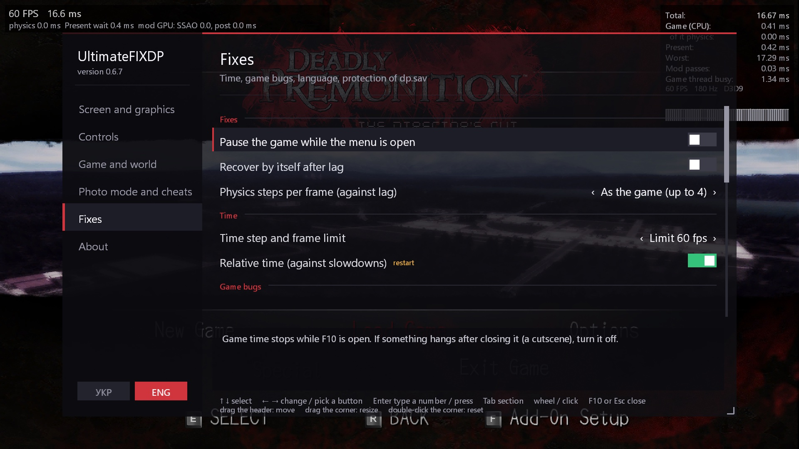

<div align="center">

# UltimateFIXDP

**The all-in-one fix for _Deadly Premonition: The Director's Cut_ (PC, Steam)**
<br>
_Універсальний фікс для_ **Deadly Premonition: The Director's Cut** _(PC, Steam)_

[](https://github.com/LittleBitUA/UltimateFIXDP/releases)
[](LICENSE)
[](https://store.steampowered.com/app/247660/)
[](https://t.me/LittleBitUA)

**[⬇️ Download / Завантажити](https://github.com/LittleBitUA/UltimateFIXDP/releases/latest)** · **[🇬🇧 English](#-english)** · **[🇺🇦 Українська](#-українська)**


</div>

> [!NOTE]
> **Public testing.** Most features are tested in game, the rest are marked _experimental_. Back up `savedata\dp.sav` before you start.
> <br>**Публічне тестування.** Більшість функцій перевірено в грі, решту позначено як _експериментальні_. Перед початком зробіть копію `savedata\dp.sav`.

> [!TIP]
> **Used [DP1 Launcher](https://github.com/dplauncher/DP1-Launcher)?** UltimateFIXDP is its successor. What the launcher set up through DPfix, the 4 GB patch and DXVK (resolution, SSAO, borderless, save backups) is now built into the mod itself, with far more fixes. Remove DPfix before installing.
> <br>**Користувались [DP1 Launcher](https://github.com/dplauncher/DP1-Launcher)?** UltimateFIXDP — його наступник. Те, що лаунчер налаштовував через DPfix, 4GB-патч і DXVK (роздільність, SSAO, вікно без рамки, копії сейвів), тепер вбудовано в сам мод, і виправлень набагато більше. Перед установкою приберіть DPfix.

---

## 🇬🇧 English

One file, `X3DAudio1_7.dll`, in the game folder. No exe patching, no installer, a full settings menu in game (**F10**).

### ✨ Highlights

| | |
|---|---|
| 🛡️ **Stability** | The crash after cutscenes, the zero-frame-time freeze, the Alt+Tab hang, the "only a reboot helps" slowdown. Crash handler and freeze watchdog for anything left. |
| 🚀 **Performance** | Found why the game sits at ~45 FPS on some PCs (a gamepad poll every frame): **45 → 180 FPS** in our test. A 60 FPS limit that works at any refresh rate. |
| 🖥️ **Graphics** | Borderless window, **real output resolution** (sharp HUD and text), supersampling 1×–3×, SSAO, FXAA, sharpening, wet reflections, 16× AF, longer draw distance. |
| 🎮 **DualSense** | USB and Bluetooth without Steam Input, **adaptive triggers per weapon**, rumble that finally works, haptics for driving and shooting, PlayStation button icons. |
| 🗺️ **Map** | The full pause map (64 tiles, proper zoom, north up), **waypoints** with the game's own minimap arrows. |
| 📷 **Photo mode** | Free camera, frozen time, filters, FOV, costumes, poses, PNG screenshots. _Experimental._ |
| 💾 **Saves** | Atomic writes, backups, automatic restore of a damaged save. |

### 🖼️ Screenshots

<table>
<tr>
<td></td>
<td></td>
</tr>
<tr>
<td></td>
<td></td>
</tr>
</table>

### 📦 Installation

1. **Back up** `savedata\dp.sav`.
2. Download the [latest release](https://github.com/LittleBitUA/UltimateFIXDP/releases/latest) and copy `X3DAudio1_7.dll` and the `UltimateFix` folder into the game folder (next to `DP.exe`).
3. Start the game and press **F10**. Settings are saved to `UltimateFix.ini`, the log to `UltimateFix\ufx.log`.

> [!IMPORTANT]
> Steam version **1.01b** only. Other builds are detected and the mod stays inactive.
> <br>For DualSense, turn off Steam Input for the game (Properties → Controller).
> <br>Do not combine with ZachFix or DPStabilityFix: they patch the same places.

<details>
<summary><b>Optional extras in the release</b></summary>

- `ufx_laa.exe` lets `DP.exe` use 4 GB of memory (useful with high supersampling). It keeps `DP.exe.bak`; `ufx_laa.exe --undo` reverts it.
- `ufx_play.exe` is the quick start without the launcher window. The mod installs it by itself; hold **Shift** at start for the old launcher once, `ufx_play.exe --undo` reverts it.
- `dxvk\Install_DXVK.bat` / `Remove_DXVK.bat` turn DXVK (Vulkan) on and off. _Experimental, not tested in game yet._

**Uninstall:** delete `X3DAudio1_7.dll` (and `UltimateFix\` if you like).
</details>

### ⌨️ Keys

| Key | Action |
|---|---|
| **F10** | Settings menu |
| **F7** | Set a waypoint (on the pause map or in the world) · **Shift+F7** removes it |
| **F6** | Photo mode (camera, frozen time, panel) |
| **F5 / F4** | Free camera only / hide the HUD in photo mode |
| **F11** | Screenshot (PNG, without the menu) |
| **F9** | Profiler (writes a profile to the log) |
| DualSense touchpad click | Same as F7 |

<details>
<summary><b>📋 Everything it does, in detail</b></summary>

#### Stability and fixes
- **The "only a PC reboot helps" slowdown.** The game's timer lost precision after long Windows uptime (x87 float time). The mod hands it a counter that starts with the game.
- **Low FPS on some systems.** The game asked Windows about a WinMM gamepad on every frame, even with none connected, and on some PCs that call is very slow (45 FPS with the GPU at 4%). The mod now asks twice a second.
- **Crashes**: the NPC-after-cutscene crash, the freeze on a zero frame time (division by zero), the hang after Alt+Tab in windowed mode, and others. A crash handler and a freeze watchdog write a dump and a log line if anything still goes wrong.
- **Day and night inside buildings.** The port read the building list (`HOUSE_LIST`) with a wrong key, so most interiors had the wrong lighting.
- **Safer saves**: the game wipes `dp.sav` before writing it. The mod writes to a temporary file and replaces the save in one step, keeps backups, and restores the last good copy if a save is damaged.
- **60 FPS limit at any refresh rate.** At 144/180 Hz the game used to run too fast.
- **Normal difficulty by default** (the PC port forced Easy).
- **No launcher window**: the game starts straight away.

#### Display and graphics
- Borderless window on the whole monitor, aspect-correct scaling, no blur on 125%/150% DPI screens.
- Real output resolution: the back buffer and the HUD are drawn at your monitor's resolution instead of 1280×720.
- Supersampling of the 3D scene (1×, 1.5×, 2×, 3×), sharper shadows, SSAO, FXAA, sharpening, 16× anisotropic filtering, wet reflections, longer draw distance.

#### DualSense and gamepads
- DualSense over USB or Bluetooth, read directly: no Steam Input needed.
- Adaptive triggers per weapon (pistol, magnum, shotgun, SMG, rifle, rocket launcher), turned off while driving.
- Rumble works: the PC port calculated vibration and never sent it anywhere. Extra haptics: engine hum while driving, a kick on every shot.
- Aim on L2, shoot on R2, like a modern shooter (Xbox pads too). PlayStation button icons, automatic keyboard/pad prompt switching.

#### Map and navigation
- Full pause map: all 64 tiles, proper zoom, north up (optional).
- Waypoint: F7 on the pause map sets it at the map centre, F7 in the world where you stand. A distance label in the game's own font, and the game's own arrows on the minimap edge. _Minimap arrows are experimental._

#### Photo mode and extras (_experimental_)
- Free camera, frozen time, filters, field of view, costumes, poses, HUD toggle, PNG screenshots.
- Cheats page: money, time of day, weather, ammo, god mode.
- Tools: frame statistics panel, built-in sampling profiler, freeze watchdog.

#### How it works
UltimateFIXDP is a proxy `X3DAudio1_7.dll`: the game loads it like the real audio library, the mod passes every audio call on to the real one and patches the game in memory. Every patch first checks the game's code byte by byte. If something does not match (another build, or another mod already patched that spot), only that patch switches itself off and the log says why.
</details>

<details>
<summary><b>🩺 If something goes wrong</b></summary>

- Look in `UltimateFix\ufx.log`: every patch says whether it is active or skipped, and why.
- Every feature can be switched off in F10 or in `UltimateFix.ini`; `[Debug] SafeMode=1` starts the mod with fewer hooks.
- When reporting a problem, attach `ufx.log` and, if there is one, the `crash_*.dmp` / `hang_*.dmp` file.
- An old `UltimateFix.ini` keeps old values. If defaults look wrong after an update, delete it and the mod writes a fresh one.
</details>

<details>
<summary><b>🔧 Building from source</b></summary>

mingw-w64 (i686), freestanding C++17 without the C runtime. The DLL imports only `kernel32`, `user32` and `gdi32`.

```
make                                  # build/X3DAudio1_7.dll (needs i686-w64-mingw32-g++ and xxd)
make test DPEXE=/path/to/DP.exe       # checks every patch site and stub against a real DP.exe
```

`src/` the mod (`modules/` one file per feature, `sites.h` every patched address with its expected bytes, `ui/` the F10 menu) · `tests/` host tests · `tools/` launcher stub, LAA patcher, save/archive helpers.
</details>

---

## 🇺🇦 Українська

Один файл, `X3DAudio1_7.dll`, у теці гри. Без правок exe, без інсталятора, повне меню налаштувань у грі (**F10**).

### ✨ Головне

| | |
|---|---|
| 🛡️ **Стабільність** | Виліт після катсцен, зависання на нульовому кадрі, зависання після Alt+Tab, гальмування, яке лікувалось лише перезавантаженням ПК. Обробник вильотів і сторож зависань на все інше. |
| 🚀 **Швидкодія** | Знайшли, чому на деяких ПК гра тримається на ~45 FPS (опитування ґеймпада щокадру): **45 → 180 FPS** у нашому тесті. Ліміт 60 FPS на будь-якій частоті екрана. |
| 🖥️ **Графіка** | Вікно без рамки, **справжня вихідна роздільність** (чіткі HUD і текст), суперсемплінг 1×–3×, SSAO, FXAA, різкість, мокрі відбиття, анізотропія 16×, більша дальність промальовки. |
| 🎮 **DualSense** | USB і Bluetooth без Steam Input, **адаптивні триґери під кожну зброю**, вібрація, яка нарешті працює, відгук у машині й при пострілах, іконки кнопок PlayStation. |
| 🗺️ **Мапа** | Повна мапа паузи (64 плитки, нормальний масштаб, північ угорі), **мітки** з рідними стрілками гри на мінімапі. |
| 📷 **Фоторежим** | Вільна камера, зупинка часу, фільтри, кут огляду, костюми, пози, знімки PNG. _Експериментально._ |
| 💾 **Збереження** | Атомарний запис, резервні копії, автоматичне відновлення пошкодженого сейву. |

### 📦 Установка

1. **Зробіть копію** `savedata\dp.sav`.
2. Завантажте [останній реліз](https://github.com/LittleBitUA/UltimateFIXDP/releases/latest) і скопіюйте `X3DAudio1_7.dll` і теку `UltimateFix` у теку гри (поруч із `DP.exe`).
3. Запустіть гру і натисніть **F10**. Налаштування зберігаються в `UltimateFix.ini`, журнал у `UltimateFix\ufx.log`.

> [!IMPORTANT]
> Лише Steam-версія **1.01b**. Інші збірки мод розпізнає і не вмикається.
> <br>Для DualSense вимкніть Steam Input для гри (Властивості → Контролер).
> <br>Не поєднуйте з ZachFix і DPStabilityFix: вони змінюють ті самі місця.

<details>
<summary><b>Необов'язкові додатки в релізі</b></summary>

- `ufx_laa.exe` дозволяє `DP.exe` використовувати 4 ГБ пам'яті (корисно з великим суперсемплінгом). Робить копію `DP.exe.bak`; `ufx_laa.exe --undo` повертає як було.
- `ufx_play.exe` — швидкий старт без вікна лаунчера. Мод ставить його сам; утримуйте **Shift** при запуску, щоб один раз відкрити старий лаунчер, `ufx_play.exe --undo` повертає як було.
- `dxvk\Install_DXVK.bat` / `Remove_DXVK.bat` вмикають і вимикають DXVK (Vulkan). _Експериментально, у грі ще не перевірено._

**Видалення:** видаліть `X3DAudio1_7.dll` (і за бажанням `UltimateFix\`).
</details>

### ⌨️ Клавіші

| Клавіша | Дія |
|---|---|
| **F10** | Меню налаштувань |
| **F7** | Поставити мітку (на мапі паузи або у світі) · **Shift+F7** прибирає |
| **F6** | Фоторежим (камера, зупинка часу, панель) |
| **F5 / F4** | Лише вільна камера / сховати HUD у фоторежимі |
| **F11** | Знімок екрана (PNG, без меню) |
| **F9** | Профайлер (пише профіль у журнал) |
| Клік по тачпаду DualSense | Те саме, що F7 |

<details>
<summary><b>📋 Усе, що він робить, докладно</b></summary>

#### Стабільність і виправлення
- **Гальмування, яке лікувалось лише перезавантаженням ПК.** Таймер гри втрачав точність, коли Windows довго працює (час у x87 float). Мод дає їй лічильник, який починається разом із грою.
- **Низький FPS на деяких системах.** Гра щокадру питала Windows про ґеймпад WinMM, навіть коли його немає, а на деяких ПК цей виклик дуже повільний (45 FPS при завантаженні відеокарти 4%). Тепер мод питає двічі на секунду.
- **Вильоти**: виліт NPC після катсцени, зависання на нульовому кроці кадру (ділення на нуль), зависання після Alt+Tab у вікні та інші. Обробник вильотів і сторож зависань пишуть дамп і рядок у журнал, якщо щось усе ж трапиться.
- **День і ніч у будівлях.** PC-порт читав список будівель (`HOUSE_LIST`) з неправильним ключем, тож у більшості приміщень було не те освітлення.
- **Надійніші збереження**: гра стирає `dp.sav` перед записом. Мод пише в тимчасовий файл і замінює сейв одним кроком, тримає резервні копії, а пошкоджений сейв відновлює з останньої доброї.
- **Ліміт 60 FPS на будь-якій частоті екрана.** На 144/180 Гц гра раніше бігла надто швидко.
- **Звичайна складність за замовчуванням** (PC-порт примусово ставив легку).
- **Без вікна лаунчера**: гра стартує одразу.

#### Екран і графіка
- Вікно без рамки на весь монітор, масштабування зі збереженням пропорцій, без розмиття на екранах 125%/150%.
- Справжня вихідна роздільність: задній буфер і HUD малюються в роздільності монітора, а не 1280×720.
- Суперсемплінг 3D-сцени (1×, 1,5×, 2×, 3×), чіткіші тіні, SSAO, FXAA, різкість, анізотропна фільтрація 16×, мокрі відбиття, більша дальність промальовки.

#### DualSense і ґеймпади
- DualSense напряму через USB або Bluetooth: Steam Input не потрібен.
- Адаптивні триґери під кожну зброю (пістолет, магнум, дробовик, автомат, гвинтівка, гранатомет), у машині вимикаються.
- Вібрація працює: PC-порт рахував її, але нікуди не надсилав. Додатковий відгук: гул двигуна в машині, поштовх на кожен постріл.
- Приціл на L2, постріл на R2, як у сучасних шутерах (і для Xbox-падів). Іконки кнопок PlayStation, автоматичне перемикання підказок між клавіатурою й ґеймпадом.

#### Мапа й навігація
- Повна мапа паузи: усі 64 плитки, нормальний масштаб, північ угорі (за бажанням).
- Мітка: F7 на мапі паузи ставить її в центрі мапи, F7 у світі — там, де ви стоїте. Напис із відстанню ігровим шрифтом і рідні стрілки гри на краю мінімапи. _Стрілки на мінімапі експериментальні._

#### Фоторежим і додатки (_експериментально_)
- Вільна камера, зупинка часу, фільтри, кут огляду, костюми, пози, приховування HUD, знімки PNG.
- Сторінка читкодів: гроші, час доби, погода, набої, невразливість.
- Інструменти: панель статистики кадру, вбудований профайлер, сторож зависань.

#### Як це працює
UltimateFIXDP — це підмінний `X3DAudio1_7.dll`: гра вантажить його як справжню бібліотеку звуку, мод передає всі звукові виклики справжній бібліотеці й виправляє гру в пам'яті. Кожна правка спершу звіряє код гри байт у байт. Якщо щось не збігається (інша збірка або інший мод уже змінив це місце), вимикається лише ця правка, а в журналі написано чому.
</details>

<details>
<summary><b>🩺 Якщо щось не так</b></summary>

- Загляньте в `UltimateFix\ufx.log`: кожна правка пише, чи вона ввімкнена, чи пропущена, і чому.
- Будь-яку функцію можна вимкнути в F10 або в `UltimateFix.ini`; `[Debug] SafeMode=1` запускає мод із меншою кількістю хуків.
- Коли повідомляєте про проблему, додайте `ufx.log` і, якщо є, файл `crash_*.dmp` / `hang_*.dmp`.
- Старий `UltimateFix.ini` зберігає старі значення. Якщо після оновлення типові налаштування виглядають не так, видаліть його, і мод створить новий.
</details>

<details>
<summary><b>🔧 Збірка з коду</b></summary>

mingw-w64 (i686), C++17 без C runtime. DLL імпортує лише `kernel32`, `user32` і `gdi32`.

```
make                                  # build/X3DAudio1_7.dll (потрібні i686-w64-mingw32-g++ і xxd)
make test DPEXE=/шлях/до/DP.exe       # звіряє кожне місце правки й кожну заглушку зі справжнім DP.exe
```

`src/` сам мод (`modules/` по файлу на функцію, `sites.h` з кожною адресою правки та очікуваними байтами, `ui/` меню F10) · `tests/` тести на хості · `tools/` заглушка лаунчера, патчер LAA, помічники для сейвів і архівів.
</details>

---

## 💛 Credits · Подяки

The code is our own; ideas and research came from earlier community work. Thank you to their authors.
<br>Код наш власний; ідеї та дослідження взято з попередніх робіт спільноти. Дякуємо їхнім авторам.

| Project · Проєкт | Author · Автор |
|---|---|
| [ZachFix](https://github.com/h714je/ZachFix) | h714je |
| [DPfix](https://github.com/PeterTh/dpfix) | Durante (Peter Thoman) |
| [DPStabilityFix](https://github.com/Cesario67/DeadlyPremonitionFix) | Cesario67 |
| [CrashFix](https://github.com/Behelit09/DeadlyPremonition-CrashFix) · [MapFix](https://github.com/Behelit09/Deadly-Premonition-The-Director-s-Cut-MapFix) · [FreeCam](https://github.com/Behelit09/DeadlyPremonition-FreeCam) | Behelit09 |
| [DPRecomp](https://github.com/LittleBitUA/DPRecomp) — our Xbox 360 recompilation, used to compare the PC code with the original · наша рекомпіляція версії для Xbox 360, з якою ми порівнювали код PC-версії | «Little Bit» |
| [Kenney Input Prompts](https://kenney.nl/assets/input-prompts) — gamepad icons · іконки ґеймпадів (CC0) | Kenney |
| [DXVK](https://github.com/doitsujin/dxvk) — optional extra under its own license · необов'язковий додаток під власною ліцензією (`dxvk/LICENSE-DXVK.txt`) | doitsujin |

<div align="center">

Deadly Premonition belongs to its owners. This project ships no game files.
<br>Deadly Premonition належить своїм правовласникам. Проєкт не містить файлів гри.

**MIT** · [LICENSE](LICENSE) · made in 🇺🇦 by [«Little Bit»](https://t.me/LittleBitUA)

</div>
