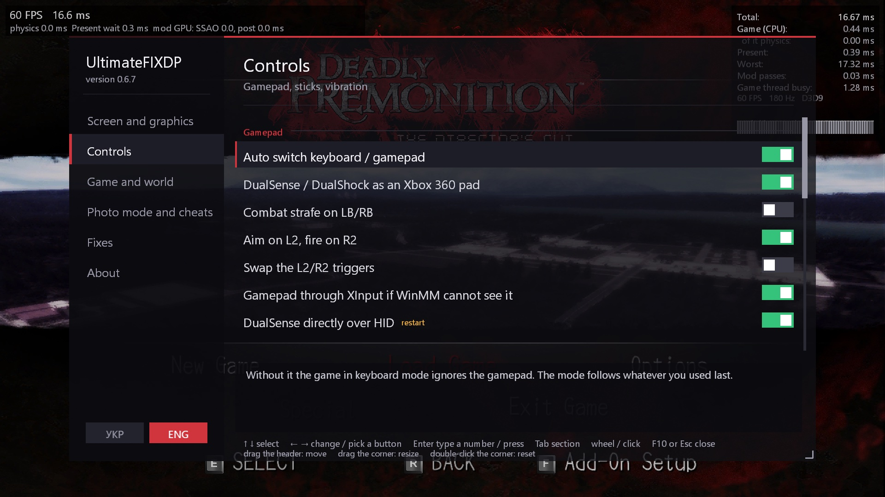

<div align="center">


# UltimateFIXDP

**The all-in-one fix for _Deadly Premonition: The Director's Cut_**
<br>
_Універсальний фікс для_ **Deadly Premonition: The Director's Cut**

[](https://github.com/LittleBitUA/UltimateFIXDP/releases)
[](https://github.com/LittleBitUA/UltimateFIXDP/releases)
[](https://ultimatefixdp.github.io/)
[](LICENSE)
[](https://store.steampowered.com/app/247660/)
[](https://t.me/LittleBitUA)


</div>

---

## 🇬🇧 In English

One DLL in the game folder instead of DPfix, a stability fix, a map fix and a crash fix.
No installer: press **F10** in game and everything is there. The mod also gives the game 4 GB of memory by itself (from the second start).

> **Version 0.7.11.** Most features are tested in game, the rest are marked _experimental_. Back up `savedata\dp.sav` first.
> <br>New in 0.7.11: the river fix works by default only in its scene — see [What's new](#whats-new-in-0711). In 0.7.10: **the river has water again** (ripples, glints and reflection as on the Xbox 360), **York's face in the photo mode** — see [What's new](#whats-new-in-0710). In 0.7.9: **a new Mods page** with each mod's picture and description, **the F10 menu on a gamepad**, no stutter without a pad, adaptive sharpening (AMD RCAS) — see [What's new](#whats-new-in-079). In 0.7.8: **a redesigned F10 menu** (crisp text, the website's palette, quiet motion, changed settings marked) and **five graphics options** (filters under the interface, smoother far shadows, smooth glow, dither against banding, the game's own edge filter) — see [What's new](#whats-new-in-078). In 0.7.7: **an Xbox pad without Steam Input**. In 0.7.6: **PlayStation icons on a DualSense (Edge too)**. In 0.7.5: texture replacements in mod folders work. In 0.7.4: **York can fly** (cheats, F3), the lock-on aims at the chest instead of the hips. In 0.7.3: a mod's name, author and version in a plain `mod.txt`. In 0.7.2: **updates itself** (F9 on the start card), a much smaller archive — see [What's new](#whats-new-in-072). In 0.7.1: fixes for the **thread races** behind the crashes and hangs on entering buildings, the **QTE at high FPS**, **4 GB of memory by itself**, checked and compressed save backups, the game's own Xbox icons — see [What's new](#whats-new-in-071).

### Features

- 🛡️ **Stability** — the crash after cutscenes, the zero-frame-time freeze and the Alt+Tab hang are fixed; a crash handler and a freeze watchdog write a dump if anything still goes wrong
- 🚀 **Low FPS fixed** — on some PCs the game sat at ~45 FPS with an idle GPU; **45 → 180 FPS** in our test
- ⏱️ **60 FPS limit at any refresh rate** — at 144 / 180 Hz the game used to run too fast
- 🖥️ **Real output resolution** — the picture and the HUD at your monitor's resolution instead of 1280×720, borderless window, no DPI blur
- ✨ **Graphics** — supersampling 1×–3×, horizon-based ambient occlusion (HBAO), SMAA and FXAA, adaptive sharpening (AMD RCAS), wet reflections, 16× anisotropic filtering, sharper shadows, longer draw distance
- 📺 **Xbox 360 look** — the console's colour grading and TV gamma on top of the PC picture
- 🌫️ **No more flickering far textures** — the game's camera wasted depth precision; far roads, roofs and decals no longer fight each other
- 🏎️ **High FPS physics** — 120–180 FPS with the car, doors, animations and timers at their normal speed; the FPS is unlocked by default
- 🧩 **Mod manager** — `UltimateFix\mods\<mod>\`: translations (SWERY Localization Tool files), texture packs, or any game file by its name (`fontwide.xpc`, `mes_all.mes`); order and on/off in F10, each mod with its picture and description — see [Making a mod](#making-a-mod)
- 🎮 **DualSense** — USB and Bluetooth without Steam Input, **adaptive triggers per weapon**, haptics for driving and shooting, PlayStation button icons
- 📳 **Rumble that works** — the PC port calculated vibration and never sent it to the gamepad
- 🔫 **Aim on L2, shoot on R2** — like a modern shooter, on Xbox pads too; prompts switch between keyboard and gamepad by themselves
- 🗺️ **Full pause map** — all 64 tiles, proper zoom, north up
- 📍 **Waypoints** — F7 sets a mark; the distance in the game's own font and the game's own arrows on the minimap (_arrows are experimental_)
- 💾 **Safe saves** — atomic writes, 60 backups named by episode, chapter and play time, automatic restore of a damaged `dp.sav`
- 📖 **Story and residents** — where the story stands and where to go next, side quests, and the timetable of every resident of Greenvale
- 🖱️ **Camera** — field of view in play, Xbox 360 quick turn, mouse sensitivity and inversion per axis
- 📷 **Photo mode** — free camera, frozen time, 13 filters with grain, sepia, aberration and letterbox, your own presets, FOV, costumes, poses, PNG screenshots
- 🧰 **Tools** — frame statistics panel, built-in profiler, cheats page (money, time, weather, ammo, god mode, York flies)
- 🇺🇦🇬🇧 **Two languages** — Ukrainian and English, switched in the menu

### Engine fixes (RE-based)

Every fix below comes from reverse engineering the game and comparing the PC
port with the Xbox 360 original:

- 🕒 **The "only a reboot helps" slowdown** — the game counted time from
  the Windows uptime counter in single-precision x87 floats, so after days
  without a reboot the frame time lost precision. The mod hands the game a
  counter that starts with the game.
- 🎯 **The 45 FPS mystery** — the game asks Windows about a WinMM gamepad on
  every frame, even with none connected, and on some systems that call takes
  milliseconds. Found with the mod's own profiler; a missing pad is now asked
  about on a background thread, so the game never waits for that answer.
- 🌗 **Day and night inside buildings** — the port reads the building list
  (`HOUSE_LIST`) with a wrong byte-order key: 64 of its 81 entries were misread, so
  interiors had the wrong lighting.
- 💥 **The crash after cutscenes** — an NPC told to walk to waypoint `-1`
  read the navigation table out of bounds. Guarded at the lookup.
- ➗ **The zero-delta freeze** — a frame with zero time divided by zero and
  spun forever. Guarded.
- 🎚️ **Difficulty** — the PC port skips the difficulty screen and stays on
  Easy forever. Normal is the default again, and the choice is yours.
- 📳 **Vibration** — the same event-to-rumble table as on Xbox 360, but the
  PC port never sends it to the device. Restored.
- 🚧 **Draw distance** — booths and vending machines vanished 500 units
  away because of a far plane the Xbox version does not have.
- 🌫️ **Flickering far away** — the play camera's near plane sits at 1.0, so
  the 24-bit depth buffer had almost no precision left in the distance. The
  mod moves it to 20.0: far surfaces stop fighting each other.
- ⚙️ **Above 120 FPS** — 80 timers of the game turned the frame time into
  whole ticks, so above 120 FPS they stood still or ran double. They now share
  whole steps.
- 🧮 **Angles that are not a number** — the angle normalisation hangs the game
  for good on a NaN (`jmp $`). It now returns 0 and logs the caller.
- 🧵 **Why "Windows 98 compatibility mode" helped** — two worker threads of the
  game share data with the main thread without any lock: the world builder
  works while the next frame already updates, and a level change clears the
  residents while the route thread still writes a path into one of them (memory
  damage, or a resident who waits for a route forever). One CPU core hid both.
  The mod makes them wait for each other instead, at full speed.
- 🕹️ **The QTE at high FPS** — the stick-waggle QTE multiplied the stick travel
  by the frame time, so at 180 FPS every A↔D swap counted a third and the QTE
  ran out of time. A swap now counts as at 60 FPS.
- 🧠 **2 GB of memory** — the game is 32-bit and sees only 2 GB; a big render
  scale runs it out. The mod gives `DP.exe` the 4 GB flag by itself (from the
  next start, the original kept as `DP.exe.bak`).
- 🧍 **Residents walking into nowhere** — a failed route lookup moved the
  resident to (0, 0, 0); now the resident stays where it stood.
- 🧰 **"Cannot take items from the toolbox" and the frozen side missions
  list** — a panel that opens starts at zero opacity, and a frame of zero
  length (days of Windows uptime, hundreds of FPS) left it there: the game
  took it for closed. The toolbox fell back to the WEAPONS/ITEMS choice, the
  side missions list and the map's mission view hung on an empty screen. The
  panel now waits for the next frame (`[Fixes] ZeroFrameMenus`; not yet checked
  in the game, `[Debug] ForceZeroFrame` reproduces the bug).
- 🌊 **The river that was a flat blue strip** (0.7.10) —
  on the Xbox 360 the river is grey-teal, covered with moving ripples and
  glints. On PC it is a smooth blue ribbon, as if the water were missing.
  The water itself is there, two things are lost on the way to the screen:
  - **The river's own settings are never applied.** The game's water table
    has an entry named `_river`: reflection 100 %, weight 100 %. The PC port
    draws the river with the values of an object that has no entry at all:
    reflection 0. The game's water shader multiplies the reflection, the
    lighting of the waves and the glints by that number, so all three come
    out as zero and only the river's 4×4 one-colour texture is left. The mod
    hands the river's draws the values of the `_river` entry. Why the port
    does not find the entry by itself is not known yet.
  - **The waves are smaller than a pixel.** The Xbox 360 renders a wave
    texture for each water object; the PC port replaced that with one wave
    map shared by all water, and on the river it repeats so often that the
    waves turn into white noise. The mod draws it 16 times larger. That
    number was picked by eye against Xbox 360 footage, the console's own
    value has not been measured.

  `[Fixes] RiverWater`: 0 off, 1 always, 2 only in the scene by the river (the
  default since 0.7.11); switched in the F10 menu at once.
  Checked in the game at the river; other water (the lake, puddles,
  interiors) has not been compared yet.

### What's new in 0.7.11

**The river fix now belongs to its scene.** In 0.7.10 the river was drawn with its ripples, glints and reflection everywhere. From 0.7.11 the fix works by default only in the scene by the river, "Welcome to Greenvale" (York's arrival), the one place the game shows the river up close; everywhere else the water stays as the port draws it. The row "River water as on the Xbox 360" on the Fixes page has three values: Off, Always, Only in the river scene (`[Fixes] RiverWater=0 / 1 / 2`), switched at once. Checked in the game: fixed in the scene, the port's water right after it. A file that still had the 0.7.10 default (Always) is moved to the new default once; pick Always again if you prefer it.

### What's new in 0.7.10

**The river has water again.** On PC the river was a flat blue strip; on the Xbox 360 it is grey-teal, with moving ripples and glints. Two things were lost in the port: the river's own entry of the game's water table (`_river`: reflection 100 %) is never applied, so the shader multiplied the reflection, the lit waves and the glints by zero; and the wave map repeated so often that the waves were smaller than a pixel. The mod gives the river the values of its entry and draws the wave map 16 times larger (picked by eye against Xbox 360 footage). On by default, row "River water as on the Xbox 360" on the Fixes page (`[Fixes] RiverWater`), switched at once. Checked in the game at the river; other water (the lake, puddles, interiors) has not been compared yet. The full story is under [Engine fixes](#engine-fixes-re-based).

**Photo mode: York's face.** A "York's face" group on the photo page: emotion, brows, lids and mouth, each picked by name with its own strength, plus a wrinkled nose, "over the game's face" and "no blinking". The parts mix (a sad emotion with sceptical brows). Works in the game.

**Photo mode, smaller things:**
- **Suits as you scroll.** York wears the suit the list rests on (after a third of a second); the "Wear" button is gone.
- **Body motions** (_experimental_): any motion of York, the residents, the cutscenes or the Raincoat Killer by number, held on a frame or played. Not yet confirmed in the game.
- **Leaving the photo mode** puts York's own motion and face back, however it is closed.
- **F4 hides the minimap too**, not only the rest of the interface.
- **No dimming behind the menu** on any page: the game's brightness no longer jumps between sections.

### What's new in 0.7.9

**The Mods page, redesigned.** A list on the left (the mod's picture, name, version and author, its switch) and a card on the right for the selected mod: its **picture (350×350)**, name, version, author, whether it is on, what it brings, buttons to move it up or down and to open its folder, and its **whole description**. How to give your mod a picture and a description: see [Making a mod](#making-a-mod).

**The F10 menu on a gamepad.** View + Menu together (on a DualSense Create + Options) opens and closes it. The D-pad or the left stick moves (held, it repeats; sliders speed up), A / Cross picks, B / Circle goes back, Y / Triangle puts the default back, LB / RB change the section, LT / RT scroll a screen, R3 shows a whole description, X / Square opens a mod's folder. The hints show the pad's own button icons (PlayStation ones on a DualSense). While the menu is open the game does not see the pad. Row "Gamepad control of the menu" (`[Menu] PadControl`).

**No more stutter without a gamepad.** With no pad plugged in, Windows took 18–62 ms to answer the game's question about it, twice a second. A background thread asks now, and the game gets the last answer at once (`[Input] PadPollThread`).

**Smaller things:**
- The mouse no longer takes the selection away from the arrows or the pad; the cursor hides while a pad drives the menu.
- Moving the panel (its top strip) and resizing it (the bottom right corner) work on every page.
- Questions (restore defaults, restart) show which button is focused; ← → change it.
- The About page has the website link and an "Open the log folder" button.
- **You can see what waits for a restart.** The "restart" tag turns amber only on a setting whose value differs from what runs now, and its description says what runs. The sidebar counts these settings and offers "Restart the game" (a click, R, or X / Square on a pad). It asks first, because progress since the last save is lost, and it refuses while the game is writing its save (seen with the save protection on).
- **Long descriptions in full.** A description too long for its box ends with "… F1 / R3: in full". F1, R3 on a pad or a click on the box opens it on a card over the list, scrolled with ↑ ↓ or the wheel, with the default, the value now and when a change applies. Esc, F1, B or a click outside closes it. A setting without a description (the photo sliders) gets one from its range and default.
- **An honest photo preview.** The photo mode page no longer darkens the whole picture, so brightness, contrast and the filters are judged on the real image; the list keeps enough opacity to stay readable. Hold the right mouse button (L3 on a pad) to fade the panel away and look at the picture; the game still sees no input, and a small note says to let go. "Picture" is now the second row, under the free camera. With the menu closed, a quiet strip at the bottom names the flying keys and F11 / F4 / F10 / F6 for 6 seconds (again after any F key). It is drawn after the screenshot is taken, so it is never in a picture.
- **Adaptive sharpening** (`SharpenMode=1`): sharpening now follows AMD FidelityFX RCAS. Soft detail gets the full strength and contrasty edges only a little, so branches against the sky and wires get no bright halos. `SharpenMode=0` brings back the old unsharp mask. Not yet checked in the game.

### What's new in 0.7.8

**A redesigned F10 menu:**
- **Crisp text at any resolution.** Text and lines sit on whole pixels, so the menu is as sharp as Windows text at 1080p and 1440p, also after dragging the panel. Titles and headings are set in Segoe UI Semibold.
- **One calm palette, the same as the website.** No green any more. Switches are red or grey pills with a round knob, and buttons and cards have rounded corners.
- **Quiet motion.** The menu fades in, the selection glides between rows, and a switch knob slides. Closing stays instant. You can turn it off with the row "Menu animation" (`[Menu] Animations`).
- **You can see what you changed.** A changed setting gets a grey dot, the sidebar shows how many settings changed in each section, and a slider marks its default. Backspace puts the selected setting back to its default.
- **Notices.** A notice is coloured by what it means (grey for information, amber for a warning, coral for an error). Up to three wait their turn, and with the menu open they appear inside the panel instead of over its title.

**Graphics (F10 → Screen and graphics; each can be switched off):**
- **Filters under the interface** (`FiltersUnderHud=1`): smoothing (SMAA/FXAA), sharpening and the game look apply to the 3D picture only, so subtitles and icons stay sharp.
- **Smoother far shadows** (`FarShadowFilter=1`): the far sun shadow cascade is filtered with the same four taps the game uses for the near ones. Distant shadow edges no longer step and crawl.
- **Smooth glow and depth of field** (`SmoothBloom=1`): the bloom and the blur are upscaled with a cubic filter. Halos around lamps and the out-of-focus background have no square steps at 1440p/4K.
- **Dither against banding** (`Dither=1`): a fixed, invisible noise removes the colour bands in skies, fog and dark gradients.
- **The game's own edge filter** (`GameAliasFilter`, off by default): a 4-tap filter the game has in its final shader but never uses. 1 = as written in the game, 2 = adjusted to the render scale. It is not known whether the Xbox used it.

**Also:**
- `DumpTextures` writes every texture, cube maps included, with no size limit.
- For testers: `[Debug] FrameCapture=1` + Numpad 0 writes one frame draw by draw (shaders, states and textures), a RenderDoc-like capture for this Direct3D 9 game.

### What's new in 0.7.7

- **An Xbox pad without Steam Input.** The game reads pads only through the old Windows joystick interface (WinMM), where an Xbox pad is not listed when Steam Input is off: the pad did nothing at all. The mod then hands the game the pad it reads through XInput, which needs `[Input] XInputFallback=1` (the default; in the F10 menu "Gamepad through XInput (fallback)"). If an older setup has it at 0, switch it on.
- **The log says why a pad is not seen**: the fallback switched off, no XInput library, or what XInput answers for each of its four slots.
- Tested by **EliParker**: an Xbox pad and a DualSense Edge both work, with the automatic icons (PlayStation on the DualSense, Xbox on the Xbox pad). Thank you!

### What's new in 0.7.6

- **PlayStation icons on a DualSense, the Edge included.** With `GlyphTheme=1` (automatic) the icons stayed Xbox for three reasons, all fixed:
  - When the game starts with the pad, it loads its own pad icon atlas (`UPDATA\SOURCE\MESSAGE\BTNWIDE.XPC`) instead of the keyboard one, and the mod looked only for the keyboard atlas, so it changed nothing. The mod now recognises the game's pad atlas by its bytes.
  - A texture pack that replaces the icon atlas hid it from the mod. The atlas is now recognised by the game's original file, before any replacement.
  - A DualSense over Bluetooth is found a few seconds after the start, and the icon set was chosen once, before that. It is now checked on every use.
- **Xbox icons from the mod's drawing again** (`UltimateFix\glyphs\gamepad\xbox.png`), the same look as the PlayStation set. The game's own Xbox atlas is used only when that file is missing.
- Thanks to **EliParker** for the reports and logs with a DualSense Edge.

### What's new in 0.7.5

- **Texture replacements from mods work.** A texture in a mod folder (`UltimateFix\mods\<mod>\textures\<hash>.dds` or `.png`) was found but never loaded (`could not be loaded (88760B59)` in the log): the mod looked for the file in the wrong folder. With a mod that carried textures, the own folders (`UltimateFix\textures\override\`, the DPfix and ZachFix folders) failed the same way. Fixed.

### What's new in 0.7.4

- **York flies** (F10 → Cheats, or F3): WASD relative to the camera, the mouse or Q/E turn, Space up, Ctrl down, Shift four times faster, speed slider on the page. Handy for testing a translation. While he flies the game sees no input, and his physics (ground, fall, collisions) waits; turning it off lands him through the game's own teleport sync. Turn it off near the ground: from a height he falls (invulnerability helps).
- **The lock-on aims at the chest.** The game aims at the enemy's waist and lowers the point by a tenth of the distance, so a few metres away it was the hips or the knees. Now the point stays a little above the waist (`[Fixes] LockOnAim`, `LockOnHeight`).
- **DualSense Edge**: when a Sony pad cannot be opened (another program such as DSX, DS4Windows or HidHide holds or hides it) or reports another model, the log now says so.
- For testers: `[Debug] TraceCamera=1` + Numpad 2 marks the camera at a moment; `[Debug] TraceWater=1` logs how the game draws water and which reflection it renders (Numpad 1 tries other water settings).
- The mod list in the log shows Cyrillic names correctly.

### What's new in 0.7.3

- **A mod describes itself in a plain text file.** Put `mod.txt` (or `info.txt`, or the old `mod.ini`) in the mod folder, and F10 → Mods shows its name, version, author and description:
  ```
  Name: Ukrainian translation
  Author: Little Bit
  Version: 1.0
  Description: The whole game text in Ukrainian
  ```
  Ukrainian keys work too (`Назва`, `Автор`, `Версія`, `Опис`), `:` or `=`, in any encoding Notepad saves (UTF-8, UTF-16, ANSI). A `readme.txt` in a mod folder is no longer taken for a game file.
- For testers: `[Debug] TraceWater=1` logs how the game draws water (for the coming water fix).

### What's new in 0.7.2

- **Updates itself.** At the start the mod asks GitHub once whether a newer release is out (one anonymous request). If so, the start card says so: **F9** downloads it, checks every file, replaces `X3DAudio1_7.dll` and the icons, and restarts the game. `UltimateFix.ini`, mods and save backups stay. If anything fails, everything stays as it was. Off: F10 → "Check for updates" or `[Menu] CheckUpdates=0`.
- **A smaller archive**: only the mod itself (`X3DAudio1_7.dll`, `UltimateFix`, a short readme). The untested DXVK and the separate tools are gone: the mod sets 4 GB and skips the launcher window by itself.
- **The QTE fix can be switched** (F10 → Fixes → "QTE at high FPS").
- The sampling profiler moved to **Ctrl+F9**.

### What's new in 0.7.1

- **Stability.**
  - The world builder and the main thread take turns, and a level change waits for the route thread: the crashes and hangs on entering buildings with company, the ones the Windows 98 compatibility mode used to hide.
  - Residents with a missing route stay in place instead of vanishing to (0, 0, 0).
  - The loader waits 1 ms instead of 16 between requests: fewer hitches while the town streams in.
  - No white "not responding" window during long loads.
  - A memory line in the log every minute, and a notice to save and restart when memory runs low.
- **4 GB of memory by itself**: the mod gives `DP.exe` the 4 GB flag (from the next start), no separate tool needed.
- **The stick-waggle QTE works at high FPS** again (every swap counts as at 60 FPS).
- **Saves.**
  - Every save is checked: the money, the story position and the play time must agree between the header and the record, or the mod warns.
  - 60 backups named by episode, chapter and play time, in a compressed folder (about 1 MB each instead of 8).
- **Graphics.**
  - Any photo filter or your own preset can stay on all the time.
  - Bloom strength and exposure correction.
  - The Xbox 360 look stays on in cutscenes and scripted scenes.
  - No doubled depth-of-field edges at render scale 300 %.
  - Fades, loading screens and the item notice cover the screen to the last pixel above 720p.
  - The near plane follows close cameras, so York is no longer cut at the save phone or in doorways.
- **The game's own Xbox pad icons** instead of the mod's drawing (unpacked from the game's `BTNWIDE.XPC`).
- **Screenshots**: Shift+F11 without the HUD, and "with every filter" in photo mode.
- **Mouse**: sensitivity 25–400 % that really turns faster, and inversion per axis.

Known issues: a light strip along some wall corners with HBAO, the X on the pause map drifts while the map pans, some rare scenes use another tone-map shader where the Xbox 360 look is not applied yet (the mod saves it as `UltimateFix\composite_*.bin` for support).

### What's new in 0.7.0

- **Mod manager** (F10 → Mods): every folder in `UltimateFix\mods\` is a mod; switch them on and off and set their order. A mod can carry a translation (`text\`: `mes_all.json` and `glyphmap.json` of the SWERY Localization Tool), textures (`textures\<hash>.dds`, hashes from `[Debug] DumpTextures=1`), or any game file by its name right in the mod folder (`fontwide.xpc`, `mes_all.mes`, `FONTWIDE.DDS` for the picture inside an XPC). Its name, author and version go in `mod.txt` (`Name: …`, `Author: …`, `Version: …`, `Description: …`).
- **Far texture flicker fixed**: the near plane of the play camera (20.0 instead of 1.0), mipmaps built for textures that have none, steadier far shadows.
- **HBAO**: horizon-based ambient occlusion with a depth-aware blur, worked out at up to 1080 rows on large render scales; **SMAA**; **Xbox 360 look**.
- **High FPS**: physics and the game's other timers at 120–180 FPS; the FPS is unlocked by default, the 60 limit stays on 61–139 Hz screens.
- **Camera**: field of view in play, Xbox 360 quick turn, mouse sensitivity (25–400 %) and inversion per axis.
- **Story page** (episode, chapter, side quests, where to go next by name) and **Residents page** (every resident's timetable, rooms and actions named).
- **Waypoint** as the game's own objective: its beacon over the place, arrows on the minimap edge; shown only in its own area.
- **Photo mode**: 13 filters, temperature, tint, sepia, fade, grain, chromatic aberration, letterbox, four presets of your own.
- **Stability**: no endless hang on an angle that is not a number, XAudio2 kept in memory, the x87 precision of Direct3D 9, a clear message when the graphics device cannot be created.
- **Saves**: 60 backups, each named by episode, chapter and play time.
- A start card that the settings are on **F10**; shorter menu labels; draw distance sliders stop where more adds nothing.

Known issues of 0.7.0, see 0.7.1 above for what is fixed.

### Screenshots

<table>
<tr>
<td></td>
<td></td>
</tr>
<tr>
<td></td>
<td></td>
</tr>
</table>

### Standing on the shoulders of

The code is our own (MIT). The ideas, facts and addresses came from earlier community work:

| Project | Author | What we learned from it |
|---|---|---|
| **[ZachFix](https://github.com/h714je/ZachFix)** | h714je | Research of the port, many ideas |
| **[DPfix](https://github.com/PeterTh/dpfix)** | Peter "Durante" Thoman | Resolution, shadows, texture replacement |
| **[DPStabilityFix](https://github.com/Cesario67/DeadlyPremonitionFix)** | Cesario67 | Saves, timing, DualSense layout |
| **[CrashFix](https://github.com/Behelit09/DeadlyPremonition-CrashFix)** · **[MapFix](https://github.com/Behelit09/Deadly-Premonition-The-Director-s-Cut-MapFix)** · **[FreeCam](https://github.com/Behelit09/DeadlyPremonition-FreeCam)** | Behelit09 | Navigation crash, the full map, free camera |
| **[DPRecomp](https://github.com/LittleBitUA/DPRecomp)** | «Little Bit» | Our Xbox 360 recompilation: the reference the PC port is compared with |
| **[Kenney Input Prompts](https://kenney.nl/assets/input-prompts)** | Kenney | Gamepad button icons (CC0) |
| **[AMD FidelityFX FSR 1](https://github.com/GPUOpen-Effects/FidelityFX-FSR)** | AMD | The RCAS formula of the adaptive sharpening, written in our own HLSL (MIT) |

🧪 **Testers:** **Gold flin**, **Tree Fan** and **EliParker**. Thank you for playing the unfinished builds and reporting everything that broke.

### 🤖 Who did what: Claude and Dmytro

Someone wrote to us: *"Claude, fix Deadly Premonition, make no mistakes."* So here it is, honestly.

**Claude** (Anthropic's AI model, working in Claude Code):
- wrote the mod's code: the patches and assembly stubs, the F10 menu, the updater, the checks that compare every patch with the real `DP.exe`. Every commit in this repository is co-authored by Claude;
- read the decompiled game code and the bytes of `DP.exe`, looked for the causes of the bugs and the addresses to fix them at, and carried ideas from the projects above over into our own code;
- wrote the README, the release notes and the website, and packed the test builds and the releases;
- **cannot run the game.** Claude has never seen a frame of it live: everything was written blind, from code, logs and screenshots;
- **made mistakes.** A test build with the wrong DLL inside, a key that clashed with another feature, fixes that took several tries. A person caught each of them in game.

**Dmytro Bidlov** («Little Bit»):
- came up with the project and decides what it is: what gets fixed first, what goes in and what is cut, the MIT license, the rule "our own code only", how the menu and the site look;
- played every test build on Windows and sent back logs, screenshots, saves and shader dumps. Without that, nobody would know that any of this works;
- made [DPRecomp](https://github.com/LittleBitUA/DPRecomp), the Xbox 360 recompilation the PC port is compared with, and the SWERY Localization Tool, and is making the Ukrainian translation this mod was built to carry;
- decides on every release; nothing is published without a check.

What we hold to: *"tested in game"* in this README means a person tested it in game. Everything else is marked _experimental_.

### Installation

1. Back up `savedata\dp.sav`
2. Download the latest version from [Releases](https://github.com/LittleBitUA/UltimateFIXDP/releases)
3. Copy `X3DAudio1_7.dll` and the `UltimateFix` folder into the game folder (next to `DP.exe`)
4. Start the game and press **F10**

> **Requirements:** the Steam version 1.01b of the game. Other builds are detected and the mod stays inactive.
> <br>**DualSense:** turn off Steam Input for the game (Properties → Controller).
> <br>**Do not combine** with DPfix, ZachFix or DPStabilityFix: UltimateFIXDP replaces them.
> <br>**Coming from DP1 Launcher?** This is its successor: remove DPfix (`d3d9.dll`, `DPfix.ini`) first.
> <br>**Linux / Steam Deck (Proton):** players report it works, the F10 menu included. Use **GE-Proton**: with Valve's Proton the game's videos do not play (a matter of the game under Proton, not of the mod). If F10 does nothing, add to the game's launch options: `WINEDLLOVERRIDES="x3daudio1_7=n,b" %command%`.

The release archive holds only the mod: `X3DAudio1_7.dll`, the `UltimateFix` folder and a short `README_UA.txt`. The source code is this repository. Newer versions: the mod asks GitHub at the start and offers **F9** to update itself (`[Menu] CheckUpdates=0` turns that off).

To uninstall, delete `X3DAudio1_7.dll` (and, for the 4 GB flag, put `DP.exe.bak` back as `DP.exe` or let Steam verify the files).

### Keys

| Key | Action |
|---|---|
| **F10** | Settings menu |
| **View + Menu** (DualSense: **Create + Options**) | Settings menu on a gamepad: the D-pad or left stick moves, A / Cross picks, B / Circle closes, LB / RB the section, LT / RT a screen of rows, Y / Triangle the default, R3 the whole description, X / Square a mod's folder on the Mods page, elsewhere the restart while settings wait for one, L3 held on the photo mode page the picture without the menu (`[Menu] PadControl`) |
| **F7** | Set a waypoint (on the pause map or in the world) · **Shift+F7** removes it · **Ctrl+F7** to the game's objective |
| **Shift+S** | Quick turn (on a pad: the Xbox 360 combination) |
| **F6** | Photo mode |
| **F5** / **F4** | Free camera only / hide the HUD in photo mode |
| **F11** | Screenshot (PNG, without the menu) |
| **F9** | Profiler (writes a profile to the log) |

### Making a mod

A mod is a folder in `UltimateFix\mods\` (next to `DP.exe`). F10 → Mods lists every mod with its picture, name, version and author; the selected one gets a card with the picture at 350×350 (at 1080p), what the mod brings and its whole description. What a mod folder can hold:

| File or folder | What it is |
|---|---|
| `text\` | a translation: `mes_all.json` and `glyphmap.json` of the SWERY Localization Tool, `*.txt` corrections |
| `textures\` | texture replacements `<hash>.dds` or `.png` (the hashes come from `[Debug] DumpTextures=1`) |
| game files | right in the folder by their name (`fontwide.xpc`, `mes_all.mes`, `FONTWIDE.DDS` for the picture inside an XPC) or by the game's path (`UPDATA\...`) |
| `mod.txt` | `Name: …`, `Author: …`, `Version: …`, `Description: …` (or `mod.ini`, `info.txt`; the Ukrainian keys work too); `\n` in the description starts a new line |
| `description.txt` | a longer description: the whole text of the file with its line breaks, up to 1023 characters (or `опис.txt`; UTF-8, UTF-16 or ANSI); it wins over `Description:` |
| `cover.png` | the mod's picture: a square, **350×350** recommended, PNG or JPG (`cover.jpg`, `preview.png`, `preview.jpg`, `image.png` work too); a picture that is not square is cropped to its middle |

**A picture and a description, step by step:**
1. Make a square picture, **350×350 pixels** (bigger works too: the mod scales it down; a picture that is not square is cropped to its middle, never stretched). PNG or JPG; a PNG may have transparency. The corners are rounded by the menu, so draw the picture with square corners.
2. Name it `cover.png` (or `cover.jpg`) and put it right in the mod's folder, next to `mod.txt`, not in `textures\`.
3. Write `mod.txt` (UTF-8):
   ```
   Name: Ukrainian translation
   Author: Little Bit
   Version: 1.2
   Description: The whole game in Ukrainian.\nMenus, letters and subtitles included.
   ```
   For a longer text with paragraphs, put it in `description.txt` instead (it wins over `Description:`; up to 1023 characters).
4. Restart the game: the mods are read at start. F10 → Mods shows the picture in the list and at 350×350 in the card (at 1080p; smaller on a smaller window). The log says `mods: <folder>: cover cover.png found`.

None of these files is ever taken for a game file. For example:

```
UltimateFix\mods\Ukrainian\
  mod.txt            Name: Ukrainian translation / Author: Little Bit / Version: 1.0
  description.txt
  cover.png          350×350
  text\mes_all.json
  text\glyphmap.json
```

### If something goes wrong

- `UltimateFix\ufx.log` says for every fix whether it is active or skipped, and why
- Every feature can be switched off in F10 or in `UltimateFix.ini`; `[Debug] SafeMode=1` starts with fewer hooks
- Report problems with `ufx.log` and the `crash_*.dmp` / `hang_*.dmp` file, if there is one
- After an update, an old `UltimateFix.ini` keeps old values (a few old defaults are updated by the mod itself): delete it to get all the new defaults

### Development

```bash
make                                  # build/X3DAudio1_7.dll
make test DPEXE=/path/to/DP.exe       # checks every patch site against a real DP.exe
```

Stack: **freestanding C++17** (mingw-w64 i686, no C runtime; imports only `kernel32`, `user32`, `gdi32`),
a proxy `X3DAudio1_7.dll` that passes audio calls on to the real library and patches the game in memory.
Every patch checks the game's bytes first: if they differ, only that patch switches itself off.

---

## 🇺🇦 Українською

Одна DLL у теці гри замість DPfix, фіксу стабільності, фіксу мапи й фіксу вильотів.
Без інсталятора: натисніть **F10** у грі, і все там. Мод також сам дає грі 4 ГБ пам'яті (з другого запуску).

> **Версія 0.7.11.** Більшість функцій перевірено в грі, решту позначено як _експериментальні_. Спершу зробіть копію `savedata\dp.sav`.
> <br>Нове в 0.7.11: виправлення річки типово діє лише у своїй сцені — див. [Що нового](#що-нового-в-0711). У 0.7.10: **у річці знову є вода** (брижі, відблиски й відбиття, як на Xbox 360), **міміка Йорка у фоторежимі** — див. [Що нового](#що-нового-в-0710). У 0.7.9: **нова сторінка модів** з картинкою й описом кожного мода, **меню F10 з ґеймпада**, без ривків без пада, адаптивна різкість (AMD RCAS) — див. [Що нового](#що-нового-в-079). У 0.7.8: **оновлене меню F10** (чіткий текст, палітра сайту, тихий рух, позначки змінених налаштувань) і **п'ять графічних опцій** (фільтри під інтерфейсом, згладжені далекі тіні, плавне світіння, дизеринг проти смуг, власний фільтр країв гри) — див. [Що нового](#що-нового-в-078). У 0.7.7: **Xbox-пад без Steam Input**. У 0.7.6: **іконки PlayStation на DualSense (і Edge)**. У 0.7.5: заміни текстур у теках модів працюють. У 0.7.4: **Йорк літає** (читкоди, F3), автоприціл цілиться в груди, а не в стегна. У 0.7.3: назва, автор і версія мода у звичайному `mod.txt`. У 0.7.2: **оновлюється сам** (F9 на стартовій плашці), значно менший архів — див. [Що нового](#що-нового-в-072). У 0.7.1: виправлено **гонки потоків**, через які гра падала й зависала при вході в будівлі, **QTE на високому FPS**, **4 ГБ пам'яті самі собою**, перевірені й стиснені копії збережень, оригінальні іконки Xbox — див. [Що нового](#що-нового-в-071).

### Можливості

- 🛡️ **Стабільність** — виправлено виліт після катсцен, зависання на нульовому кадрі й зависання після Alt+Tab; обробник вильотів і сторож зависань пишуть дамп, якщо щось усе ж трапиться
- 🚀 **Виправлено низький FPS** — на деяких ПК гра трималась на ~45 FPS при вільній відеокарті; у нашому тесті **45 → 180 FPS**
- ⏱️ **Ліміт 60 FPS на будь-якій частоті екрана** — на 144 / 180 Гц гра раніше бігла надто швидко
- 🖥️ **Справжня вихідна роздільність** — картинка й HUD у роздільності монітора, а не 1280×720, вікно без рамки, без розмиття від масштабування Windows
- ✨ **Графіка** — суперсемплінг 1×–3×, затінення по горизонту (HBAO), SMAA і FXAA, адаптивна різкість (AMD RCAS), мокрі відбиття, анізотропна фільтрація 16×, чіткіші тіні, більша дальність промальовки
- 📺 **Вигляд Xbox 360** — кольорокорекція й гамма телевізора консолі поверх картинки PC
- 🌫️ **Далекі текстури більше не блимають** — камера гри марнувала точність глибини; далекі дороги, дахи й написи більше не «перебивають» одне одного
- 🏎️ **Фізика на високому FPS** — 120–180 FPS, а машина, двері, анімації й таймери йдуть з нормальною швидкістю; FPS типово розблоковано
- 🧩 **Менеджер модів** — `UltimateFix\mods\<мод>\`: переклади (файли SWERY Localization Tool), текстурні паки або будь-який файл гри за іменем (`fontwide.xpc`, `mes_all.mes`); порядок і вмикання в F10, кожен мод зі своєю картинкою й описом — див. [Як зробити мод](#як-зробити-мод)
- 🎮 **DualSense** — USB і Bluetooth без Steam Input, **адаптивні триґери під кожну зброю**, відгук у машині й при пострілах, іконки кнопок PlayStation
- 📳 **Вібрація, яка працює** — PC-порт рахував її, але не надсилав на ґеймпад
- 🔫 **Приціл на L2, постріл на R2** — як у сучасних шутерах, і на Xbox-падах; підказки самі перемикаються між клавіатурою й ґеймпадом
- 🗺️ **Повна мапа паузи** — усі 64 плитки, нормальний масштаб, північ угорі
- 📍 **Мітки** — F7 ставить мітку; відстань ігровим шрифтом і рідні стрілки гри на мінімапі (_стрілки експериментальні_)
- 💾 **Надійні збереження** — атомарний запис, 60 резервних копій із підписом (епізод, розділ, час гри), автоматичне відновлення пошкодженого `dp.sav`
- 📖 **Сюжет і жителі** — де ви в сюжеті й куди йти далі, побічні завдання і розклад кожного жителя Ґрінвейла
- 🖱️ **Камера** — кут огляду в грі, швидкий розворот як на Xbox 360, чутливість миші й інверсія по кожній осі
- 📷 **Фоторежим** — вільна камера, зупинка часу, 13 фільтрів із зерном, сепією, аберацією й кінорамкою, власні пресети, кут огляду, костюми, пози, знімки PNG
- 🧰 **Інструменти** — панель статистики кадру, вбудований профайлер, сторінка читкодів (гроші, час, погода, набої, невразливість, політ Йорка)
- 🇺🇦🇬🇧 **Дві мови** — українська та англійська, перемикаються в меню

### Виправлення рушія (на основі reverse engineering)

Кожне виправлення нижче — результат розбору коду гри й порівняння PC-порту
з оригіналом для Xbox 360:

- 🕒 **Гальмування, яке лікувалось лише перезавантаженням ПК** — гра
  рахувала час від лічильника роботи Windows у x87 float одинарної точності,
  тож після кількох днів без перезавантаження час кадру втрачав точність.
  Мод дає грі лічильник, який починається разом із нею.
- 🎯 **Загадка 45 FPS** — гра щокадру питає Windows про ґеймпад WinMM,
  навіть коли його немає, а на деяких системах цей виклик триває мілісекунди.
  Знайдено вбудованим профайлером мода; тепер про відсутній ґеймпад питає
  фоновий потік, і гра на цю відповідь не чекає.
- 🌗 **День і ніч у будівлях** — порт читає список будівель (`HOUSE_LIST`)
  з неправильним ключем порядку байтів: 64 з 81 записів читались хибно, тож
  у приміщеннях було не те освітлення.
- 💥 **Виліт після катсцен** — NPC, якого відправили до точки `-1`, читав
  таблицю навігації поза її межами. Тепер там стоїть перевірка.
- ➗ **Зависання на нульовому кадрі** — кадр із нульовим часом ділив на нуль
  і крутився вічно. Тепер там стоїть перевірка.
- 🎚️ **Складність** — PC-порт пропускає екран вибору складності й назавжди
  лишає легку. Звичайна знову типова, і вибір за вами.
- 📳 **Вібрація** — та сама таблиця «подія → вібрація», що й на Xbox 360,
  але PC-порт не надсилає її на пристрій. Відновлено.
- 🚧 **Дальність промальовки** — будки й автомати зникали за 500 одиниць
  через дальню площину, якої у версії для Xbox немає.
- 🌫️ **Блимання вдалині** — ближня площина камери гри стоїть на 1.0, тож
  24-бітному буферу глибини вдалині майже не лишалось точності. Мод ставить
  20.0: далекі поверхні більше не «перебивають» одна одну.
- ⚙️ **Понад 120 FPS** — 80 таймерів гри перетворювали час кадру на цілі такти,
  тож понад 120 FPS вони стояли або бігли вдвічі швидше. Тепер вони ділять
  цілі кроки.
- 🧮 **Кут, що не є числом** — нормалізація кута назавжди вішала гру на NaN
  (`jmp $`). Тепер вона повертає 0 і пише в журнал, звідки прийшло число.
- 🧵 **Чому допомагав «режим сумісності з Windows 98»** — два фонові потоки гри
  працюють зі спільними даними без жодного замка: будівник світу працює, поки
  оновлюється наступний кадр, а зміна локації прибирає жителів, поки потік
  маршрутів ще дописує шлях одному з них (псування пам'яті або житель, що вічно
  «чекає маршрут»). Одне ядро ховало обидві вади. Мод змушує їх чекати одне
  одного, без втрати швидкості.
- 🕹️ **QTE на високому FPS** — QTE «розхитування» множило рух стіка на час
  кадру, тож на 180 FPS кожне перемикання A↔D рахувалось на третину і час
  вичерпувався. Тепер перемикання рахується, як на 60 FPS.
- 🧠 **2 ГБ пам'яті** — гра 32-бітна і бачить лише 2 ГБ; великий масштаб
  рендеру їх вичерпує. Мод сам ставить `DP.exe` прапор 4 ГБ (з наступного
  запуску, оригінал лишається як `DP.exe.bak`).
- 🧍 **Жителі, що йдуть «в нікуди»** — невдалий пошук маршруту переносив жителя
  в (0, 0, 0); тепер він лишається там, де стояв.
- 🧰 **«Не беруться речі з ящика» і зависле меню побічних завдань** — панель,
  що відкривається, починає з нульової непрозорості, а кадр нульової
  тривалості (дні роботи Windows без перезавантаження, сотні FPS) лишав її
  там: гра вважала панель закритою. Ящик повертав до вибору WEAPONS/ITEMS,
  а список побічних завдань і перегляд «mission» на карті зависали на
  порожньому екрані. Тепер панель чекає наступного кадру (`[Fixes]
  ZeroFrameMenus`; у грі ще не перевірено, `[Debug] ForceZeroFrame` відтворює
  ваду).
- 🌊 **Річка, що була пласкою синьою смугою** (0.7.10) —
  на Xbox 360 річка сіро-бірюзова, вкрита рухомими брижами й відблисками.
  На ПК це гладка синя стрічка, наче води немає. Сама вода на місці, дорогою
  до екрана губляться дві речі:
  - **Власні налаштування річки не застосовуються.** У таблиці води гри є
    запис `_river`: відбиття 100 %, вага 100 %. PC-порт малює річку зі
    значеннями об'єкта, який не має запису взагалі: відбиття 0. Шейдер води
    множить на це число відбиття, освітлення хвиль і відблиски, тож усі три
    дають нуль і лишається тільки однотонна текстура річки 4×4. Мод дає
    малюванню річки значення із запису `_river`. Чому порт сам не знаходить
    цей запис, поки не з'ясовано.
  - **Хвилі дрібніші за піксель.** Xbox 360 малює текстуру хвиль окремо для
    кожного водного об'єкта; PC-порт замінив це однією картою хвиль на всю
    воду, і на річці вона повторюється так густо, що хвилі перетворюються
    на білий шум. Мод малює її у 16 разів більшою. Це число підібрано на
    око за записами з Xbox 360, значення самої консолі не виміряно.

  `[Fixes] RiverWater`: 0 вимкнено, 1 завжди, 2 лише в сцені біля річки (типово
  від 0.7.11); перемикається в меню F10 одразу.
  Перевірено у грі біля річки; іншу воду (озеро, калюжі, приміщення) ще не
  порівнювали.

### Що нового в 0.7.11

**Виправлення річки тепер належить своїй сцені.** У 0.7.10 річка малювалася з брижами, відблисками й відбиттям усюди. Від 0.7.11 виправлення типово діє лише в сцені біля річки, «Ласкаво просимо до Грінвейла» (приїзд Йорка), єдиному місці, де гра показує річку зблизька; всюди далі вода лишається як у порті. Рядок «Вода річки, як на Xbox 360» на сторінці «Виправлення» має три значення: Вимкнено, Завжди, Лише в сцені біля річки (`[Fixes] RiverWater=0 / 1 / 2`), перемикається одразу. Перевірено у грі: у сцені вода виправлена, одразу після неї — як у порті. Файл налаштувань, у якому лишалося типове значення 0.7.10 (Завжди), один раз переводиться на нове; якщо «Завжди» вам більше до вподоби, виберіть його знову.

### Що нового в 0.7.10

**У річці знову є вода.** На ПК річка була пласкою синьою смугою; на Xbox 360 вона сіро-бірюзова, з рухомими брижами й відблисками. У порті загубилися дві речі: власний запис річки в таблиці води гри (`_river`: відбиття 100 %) не застосовується, тож шейдер множив відбиття, освітлені хвилі й відблиски на нуль; а карта хвиль повторювалася так густо, що хвилі були дрібніші за піксель. Мод дає річці значення з її запису й малює карту хвиль у 16 разів більшою (підібрано на око за записами з Xbox 360). Увімкнено типово, рядок «Вода річки, як на Xbox 360» на сторінці «Виправлення» (`[Fixes] RiverWater`), перемикається одразу. Перевірено у грі біля річки; іншу воду (озеро, калюжі, приміщення) ще не порівнювали. Докладно — у розділі [Виправлення рушія](#виправлення-рушія-на-основі-reverse-engineering).

**Фоторежим: міміка Йорка.** Група «Міміка Йорка» на сторінці фото: емоція, брови, повіки й рот, кожне вибирається за назвою і має свою силу, плюс зморщений ніс, «поверх міміки гри» і «без моргання». Частини змішуються (сумна емоція зі скептичними бровами). У грі працює.

**Фоторежим, дрібніше:**
- **Костюми під час гортання.** Йорк одягає костюм, на якому зупинився список (за третину секунди); кнопки «Одягти» більше немає.
- **Анімації тіла** (_експериментально_): будь-яка анімація Йорка, жителів, катсцен чи Вбивці в дощовику за номером, на вибраному кадрі або в русі. У грі ще не підтверджено.
- **Вихід із фоторежиму** повертає Йоркові його анімацію й міміку, хоч як його закрити.
- **F4 ховає і мінімапу**, а не лише решту інтерфейсу.
- **Меню не затемнює гру** на жодній сторінці: яскравість більше не стрибає між розділами.

### Що нового в 0.7.9

**Нова сторінка модів.** Ліворуч список (картинка мода, назва, версія й автор, перемикач), праворуч картка вибраного мода: **картинка 350×350**, назва, версія, автор, чи він увімкнений, що він несе, кнопки «Вище», «Нижче», «Відкрити теку мода» і **повний опис**. Як дати своєму моду картинку й опис: див. [Як зробити мод](#як-зробити-мод).

**Меню F10 з ґеймпада.** View + Menu разом (на DualSense Create + Options) відкриває й закриває меню. Хрестовина або лівий стік ходять (утримання повторює, повзунки прискорюються), A / хрестик вибирає, B / коло — назад, Y / трикутник повертає типове значення, LB / RB — розділ, LT / RT — екран рядків, R3 — повний опис, X / квадрат — тека мода. Підказки показують справжні іконки кнопок пада (на DualSense — PlayStation). Поки меню відкрите, гра пада не бачить. Рядок «Керування меню ґеймпадом» (`[Menu] PadControl`).

**Без ривків, коли ґеймпада немає.** Без підключеного пада Windows відповідала на питання гри про нього 18–62 мс, двічі на секунду. Тепер питає фоновий потік, а гра одразу отримує останню відповідь (`[Input] PadPollThread`).

**Дрібніше:**
- Миша більше не перебиває вибір стрілками чи падом; курсор ховається, коли меню керує пад.
- Перетягування панелі (за верхню смугу) і зміна розміру (за правий нижній кут) працюють на кожній сторінці.
- У питаннях (відновити типові, перезапуск) видно, яка кнопка вибрана; ← → перемикають.
- На сторінці «Про мод» — посилання на сайт і кнопка «Відкрити теку журналів».
- **Видно, що чекає перезапуску.** Позначка «перезапуск» стає бурштиновою лише на налаштуванні, значення якого відрізняється від того, що працює зараз, а його опис каже, що працює. Бічна панель рахує такі налаштування й пропонує «Перезапустити гру» (клік, R або X / квадрат на паді). Спершу вона питає, бо прогрес після останнього збереження втрачається, і відмовляє, поки гра записує збереження (видно з увімкненим захистом збережень).
- **Довгий опис повністю.** Опис, що не влазить у своє поле, закінчується «… F1 / R3: повністю». F1, R3 на ґеймпаді або клік по полю відкриває його на картці над списком: гортається ↑ ↓ або колесом, унизу типове значення, поточне й коли зміна діє. Закриває Esc, F1, B або клік поза карткою. Налаштування без опису (повзунки фоторежиму) отримують опис із діапазону й типового значення.
- **Чесний перегляд у фоторежимі.** Сторінка фоторежиму більше не затемнює весь кадр, тож яскравість, контраст і фільтри видно на справжній картинці; список лишається достатньо непрозорим, щоб його було легко читати. Затисніть праву кнопку миші (L3 на ґеймпаді), і панель зникне, щоб роздивитися кадр; гра при цьому не бачить натискань, а невеличкий напис просить відпустити кнопку. «Знімок» тепер другий рядок, під вільною камерою. Коли меню закрите, внизу на 6 секунд з'являється тиха смужка з клавішами польоту й F11 / F4 / F10 / F6 (знову після будь-якої F-клавіші). Вона малюється вже після знімка, тож на знімок не потрапляє.
- **Адаптивна різкість** (`SharpenMode=1`): різкість тепер працює за алгоритмом AMD FidelityFX RCAS. Нерізкі деталі вона підсилює на повну, а контрастні краї лише трохи, тож гілки на тлі неба й дроти не мають світлих ореолів. `SharpenMode=0` повертає стару різкість. У грі ще не перевірено.

### Що нового в 0.7.8

**Оновлене меню F10:**
- **Чіткий текст за будь-якої роздільності.** Текст і лінії стоять на цілих пікселях, тож меню таке ж різке, як текст Windows, на 1080p і 1440p, і після перетягування панелі. Назви й заголовки набрано Segoe UI Semibold.
- **Одна спокійна палітра, як на сайті.** Зеленого більше немає. Перемикачі стали червоними або сірими «пілюлями» з круглою кнопкою, кнопки й картки мають заокруглені кути.
- **Тихий рух.** Меню плавно з'являється, виділення ковзає між рядками, кнопка перемикача з'їжджає. Закривається меню, як і раніше, миттєво. Вимикається рядком «Анімація меню» (`[Menu] Animations`).
- **Видно, що ви змінили.** Біля зміненого налаштування стоїть сіра крапка, у бічній панелі видно, скільки змін у кожному розділі, а повзунок позначає своє типове значення. Backspace повертає вибраному налаштуванню типове значення.
- **Сповіщення.** Колір сповіщення залежить від змісту: сірий для інформації, бурштиновий для попередження, кораловий для помилки. Сповіщення стають у чергу (до трьох), а при відкритому меню показуються всередині панелі, а не поверх заголовка.

**Графіка (F10 → Екран і графіка; кожне можна вимкнути):**
- **Фільтри під інтерфейсом** (`FiltersUnderHud=1`): згладжування (SMAA/FXAA), різкість і вигляд гри накладаються лише на 3D-картинку, тож субтитри й іконки лишаються різкими.
- **Згладжені далекі тіні** (`FarShadowFilter=1`): далекий каскад сонячних тіней фільтрується тими самими чотирма вибірками, що й ближні. Краї тіней удалині більше не «сходинками» й не повзуть.
- **Плавне світіння й розфокус** (`SmoothBloom=1`): світіння й розмиття збільшуються кубічним фільтром. Ореоли ліхтарів і розмитий фон без квадратних сходинок на 1440p/4K.
- **Дизеринг проти смуг** (`Dither=1`): нерухомий непомітний шум прибирає смуги на небі, у тумані й темних переходах.
- **Власний фільтр країв гри** (`GameAliasFilter`, вимкнено за замовчуванням): 4-точковий фільтр, який є у фінальному шейдері гри, але гра його ніколи не вмикає. 1 = як записано в грі, 2 = під масштаб рендерингу. Чи вмикав його Xbox, невідомо.

**Також:**
- `DumpTextures` записує всі текстури, кубічні теж, без обмеження розміру.
- Для тестувальників: `[Debug] FrameCapture=1` + Numpad 0 записує один кадр по малюваннях (шейдери, стани, текстури), щось на кшталт RenderDoc для цієї гри на Direct3D 9.

### Що нового в 0.7.7

- **Xbox-пад без Steam Input.** Гра читає пади лише через старий інтерфейс джойстиків Windows (WinMM), а там Xbox-пада з вимкненим Steam Input немає: пад зовсім не працював. Тоді мод передає грі пад, який читає через XInput. Для цього потрібно `[Input] XInputFallback=1` (так за замовчуванням; у меню F10 «Ґеймпад через XInput (запасний)»). Якщо у старих налаштуваннях там 0, увімкніть.
- **Журнал каже, чому пад не видно**: запасний шлях вимкнено, немає бібліотеки XInput, або що XInput відповідає по кожному з чотирьох слотів.
- Перевірив **EliParker**: і Xbox-пад, і DualSense Edge працюють з автоматичними іконками (PlayStation на DualSense, Xbox на Xbox-паді). Дякуємо!

### Що нового в 0.7.6

- **Іконки PlayStation на DualSense, зокрема на Edge.** З `GlyphTheme=1` (автоматично) іконки лишались Xbox з трьох причин, усі виправлено:
  - Якщо гра стартує з ґеймпадом, вона вантажить свій ґеймпадний атлас іконок (`UPDATA\SOURCE\MESSAGE\BTNWIDE.XPC`), а не клавіатурний, а мод шукав лише клавіатурний і нічого не міняв. Тепер мод впізнає атлас гри побайтово.
  - Пак текстур, що замінює атлас іконок, ховав його від мода. Тепер атлас впізнається за оригінальним файлом гри, ще до заміни.
  - DualSense по Bluetooth знаходиться через кілька секунд після запуску, а набір іконок вибирався один раз, раніше. Тепер він перевіряється щоразу.
- **Іконки Xbox знову з малюнка мода** (`UltimateFix\glyphs\gamepad\xbox.png`), в одному стилі з PlayStation. Власний атлас Xbox гри береться лише тоді, коли цього файлу немає.
- Дякуємо **EliParker** за повідомлення й журнали з DualSense Edge.

### Що нового в 0.7.5

- **Заміни текстур із модів працюють.** Текстуру в теці мода (`UltimateFix\mods\<мод>\textures\<хеш>.dds` або `.png`) мод знаходив, але не завантажував (`could not be loaded (88760B59)` у журналі): файл шукався не в тій теці. Якщо був мод із текстурами, так само не працювали й власні теки (`UltimateFix\textures\override\`, теки DPfix і ZachFix). Виправлено.

### Що нового в 0.7.4

- **Йорк літає** (F10 → Читкоди або F3): WASD відносно камери, мишка або Q/E повертають, Space вгору, Ctrl вниз, Shift учетверо швидше, повзунок швидкості на сторінці. Зручно для перевірки перекладу. Поки він летить, гра не бачить вводу, а його фізика (земля, падіння, зіткнення) чекає; після вимкнення гра сама ставить його на землю, як після свого телепорту. Вимикайте біля землі: з висоти він упаде (згодиться невразливість).
- **Автоприціл цілиться в груди.** Гра цілилась у пояс ворога й ще опускала точку на десяту частину відстані, тож за кілька метрів це були стегна чи коліна. Тепер точка трохи вище пояса (`[Fixes] LockOnAim`, `LockOnHeight`).
- **DualSense Edge**: якщо пад Sony не вдається відкрити (його тримає чи ховає інша програма, як-от DSX, DS4Windows, HidHide) або він іншої моделі, тепер це видно в журналі.
- Для тестувальників: `[Debug] TraceCamera=1` + Numpad 2 позначає камеру в потрібну мить; `[Debug] TraceWater=1` пише, як гра малює воду і яке відбиття рендерить (Numpad 1 пробує інші параметри води).
- Список модів у журналі показує кириличні назви правильно.

### Що нового в 0.7.3

- **Мод описує себе у звичайному текстовому файлі.** Покладіть `mod.txt` (або `info.txt`, або старий `mod.ini`) у теку мода, і F10 → Моди покаже його назву, версію, автора й опис:
  ```
  Назва: Українська локалізація
  Автор: Little Bit
  Версія: 1.0
  Опис: Повний переклад тексту гри українською
  ```
  Англійські ключі теж працюють (`Name`, `Author`, `Version`, `Description`), `:` або `=`, у будь-якому кодуванні Блокнота (UTF-8, UTF-16, ANSI). `readme.txt` у теці мода більше не вважається файлом гри.
- Для тестувальників: `[Debug] TraceWater=1` пише в лог, як гра малює воду (для майбутнього виправлення води).

### Що нового в 0.7.2

- **Оновлюється сам.** На старті мод один раз питає GitHub, чи вийшла нова версія (один анонімний запит). Якщо так, про це скаже стартова плашка: **F9** завантажить її, перевірить кожен файл, замінить `X3DAudio1_7.dll` та іконки й перезапустить гру. `UltimateFix.ini`, моди й копії збережень лишаються. Якщо щось не вдасться, усе лишиться як було. Вимкнути: F10 → «Перевіряти оновлення» або `[Menu] CheckUpdates=0`.
- **Менший архів**: лише сам мод (`X3DAudio1_7.dll`, `UltimateFix`, коротка інструкція). Неперевірений DXVK і окремі програми прибрано: мод сам ставить 4 ГБ і сам прибирає вікно лаунчера.
- **Фікс QTE можна вимкнути** (F10 → Виправлення → «QTE на високому FPS»).
- Профайлер переїхав на **Ctrl+F9**.

### Що нового в 0.7.1

- **Стабільність.**
  - Будівник світу й головний потік працюють по черзі, а зміна локації чекає потік маршрутів. Це прибирає вильоти й зависання при вході в будівлі з супутниками: те, що раніше ховав режим сумісності з Windows 98.
  - Жителі без маршруту лишаються на місці, а не зникають у (0, 0, 0).
  - Потік завантаження чекає між запитами 1 мс замість 16: менше ривків, коли місто підвантажується.
  - Під час довгих завантажень немає білого вікна «не відповідає».
  - Раз на хвилину в журналі рядок про пам'ять, а коли її бракує, повідомлення «збережіться й перезапустіть».
- **4 ГБ пам'яті самі собою**: мод ставить `DP.exe` прапор 4 ГБ (діє з наступного запуску), окрема програма не потрібна.
- **QTE «розхитування» знову проходиться на високому FPS** (кожне перемикання рахується, як на 60 FPS).
- **Збереження.**
  - Кожне збереження перевіряється: гроші, місце в сюжеті й час гри мають збігатися в заголовку й записі, інакше мод попереджає.
  - 60 копій, підписаних епізодом, розділом і часом гри, у стисненій теці (близько 1 МБ кожна замість 8).
- **Графіка.**
  - Будь-який фільтр фоторежиму або власний пресет може діяти весь час.
  - Сила світіння (bloom) і поправка експозиції.
  - Вигляд Xbox 360 тримається і в катсценах та сценах без керування.
  - Без подвоєних країв розмиття на масштабі рендеру 300 %.
  - Затемнення, екрани завантаження й сповіщення про предмет накривають екран до останнього пікселя на роздільності понад 720p.
  - Ближня площина камери сама підтягується, коли камера близько: Йорка більше не зрізає біля телефону й у дверях.
- **Оригінальні іконки ґеймпада Xbox** із самої гри (розпаковуються з її `BTNWIDE.XPC`) замість намальованих модом.
- **Знімки**: Shift+F11 без інтерфейсу, у фоторежимі «з кожним фільтром».
- **Миша**: чутливість 25–400 %, що справді повертає швидше, та інверсія по кожній осі.

Відомі проблеми: світла смужка вздовж деяких кутів з HBAO; X на мапі паузи з'їжджає під час прокручування; у кількох рідкісних сценах гра бере інший шейдер, і вигляд Xbox 360 там ще не діє (мод зберігає його як `UltimateFix\composite_*.bin`, щоб додати підтримку).

### Що нового в 0.7.0

- **Менеджер модів** (F10 → Моди): кожна тека в `UltimateFix\mods\` — це мод; вмикайте, вимикайте й міняйте порядок. Мод може нести переклад (`text\`: `mes_all.json` і `glyphmap.json` із SWERY Localization Tool), текстури (`textures\<хеш>.dds`, хеші з `[Debug] DumpTextures=1`) або будь-який файл гри за іменем просто в теці мода (`fontwide.xpc`, `mes_all.mes`, `FONTWIDE.DDS` для картинки всередині XPC). Назва, автор і версія мода — у `mod.txt` (`Назва: …`, `Автор: …`, `Версія: …`, `Опис: …`).
- **Виправлено блимання далеких текстур**: ближня площина камери (20.0 замість 1.0), міпмапи для текстур без них, стабільніші далекі тіні.
- **HBAO**: затінення по горизонту з розмиттям з урахуванням глибини, на великому масштабі рендеру рахується до 1080 рядків; **SMAA**; **вигляд Xbox 360**.
- **Високий FPS**: фізика й решта таймерів гри на 120–180 FPS; FPS типово розблоковано, ліміт 60 лишається на екранах 61–139 Гц.
- **Камера**: кут огляду в грі, швидкий розворот як на Xbox 360, чутливість миші (25–400 %) та інверсія по кожній осі.
- **Сторінка «Сюжет»** (епізод, розділ, побічні завдання, куди йти далі — назвою місця) і **сторінка «Жителі»** (розклад кожного жителя, кімнати й дії людськими словами).
- **Мітка** як рідна ціль гри: її маяк над місцем, стрілки на краю мінімапи; показується лише у своїй локації.
- **Фоторежим**: 13 фільтрів, температура, відтінок, сепія, вицвітання, зерно, хроматична аберація, кінорамка, чотири власні пресети.
- **Стабільність**: немає вічного зависання на куті, що не є числом; XAudio2 тримається в пам'яті; точність x87 як у Direct3D 9; зрозуміле повідомлення, якщо графічний пристрій не створюється.
- **Збереження**: 60 резервних копій, кожна підписана епізодом, розділом і часом гри.
- Картка на старті про **F10**; коротші підписи в меню; повзунки дальності зупиняються там, де більше нічого не дає.

Відомі проблеми 0.7.0 — що виправлено, див. 0.7.1 вище.

### На чиїх плечах стоїмо

Код наш власний (MIT). Ідеї, факти й адреси взято з попередніх робіт спільноти:

| Проєкт | Автор | Чого ми з нього навчились |
|---|---|---|
| **[ZachFix](https://github.com/h714je/ZachFix)** | h714je | Дослідження порту, багато ідей |
| **[DPfix](https://github.com/PeterTh/dpfix)** | Peter «Durante» Thoman | Роздільність, тіні, підміна текстур |
| **[DPStabilityFix](https://github.com/Cesario67/DeadlyPremonitionFix)** | Cesario67 | Збереження, час, розкладка DualSense |
| **[CrashFix](https://github.com/Behelit09/DeadlyPremonition-CrashFix)** · **[MapFix](https://github.com/Behelit09/Deadly-Premonition-The-Director-s-Cut-MapFix)** · **[FreeCam](https://github.com/Behelit09/DeadlyPremonition-FreeCam)** | Behelit09 | Виліт навігації, повна мапа, вільна камера |
| **[DPRecomp](https://github.com/LittleBitUA/DPRecomp)** | «Little Bit» | Наша рекомпіляція версії для Xbox 360: еталон, з яким порівнюємо PC-порт |
| **[Kenney Input Prompts](https://kenney.nl/assets/input-prompts)** | Kenney | Іконки кнопок ґеймпада (CC0) |
| **[AMD FidelityFX FSR 1](https://github.com/GPUOpen-Effects/FidelityFX-FSR)** | AMD | Формула RCAS для адаптивної різкості, переписана нашим власним HLSL (MIT) |

🧪 **Тестувальники:** **Gold flin**, **Tree Fan** і **EliParker**. Дякуємо, що грали в недороблені збірки й повідомляли про все, що ламалось.

### 🤖 Хто що робив: Claude і Dmytro

Нам написали: *«Claude, fix Deadly Premonition, make no mistakes»*. Тож чесно.

**Claude** (ШІ-модель Anthropic, працює в Claude Code):
- написав код мода: правки й асемблерні вставки, меню F10, оновлювач, перевірки, які звіряють кожну правку зі справжнім `DP.exe`. Кожен коміт у цьому репозиторії має Claude як співавтора;
- читав декомпільований код гри й байти `DP.exe`, шукав причини багів і адреси, де їх виправити, переносив ідеї з проєктів вище у власний код;
- написав README, описи релізів і сайт, пакував тестові збірки й релізи;
- **не може запустити гру.** Claude жодного разу не бачив її наживо: усе написано наосліп, з коду, логів і скриншотів;
- **помилявся.** Тестова збірка з не тим DLL усередині, клавіша, що заважала іншій функції, виправлення, які вдавалися не з першого разу. Кожну таку помилку в грі знайшла людина.

**Dmytro Bidlov** («Little Bit»):
- придумав проєкт і вирішує, яким він буде: що виправляти першим, що додати, а що прибрати, ліцензія MIT, правило «лише власний код», вигляд меню й сайту;
- пройшов кожну тестову збірку на Windows і надсилав логи, скриншоти, збереження й дампи шейдерів. Без цього ніхто б не знав, що хоч щось тут працює;
- зробив [DPRecomp](https://github.com/LittleBitUA/DPRecomp), рекомпіляцію версії для Xbox 360, з якою порівнюємо PC-порт, і SWERY Localization Tool, і робить український переклад, заради якого цей мод і з'явився;
- вирішує щодо кожного релізу: без перевірки нічого не виходить.

Чого ми тримаємось: *«перевірено в грі»* у цьому README означає, що це перевірила в грі людина. Решту позначено як _експериментальне_.

### Встановлення

1. Зробіть копію `savedata\dp.sav`
2. Завантажте останню версію з [Releases](https://github.com/LittleBitUA/UltimateFIXDP/releases)
3. Скопіюйте `X3DAudio1_7.dll` і теку `UltimateFix` у теку гри (поруч із `DP.exe`)
4. Запустіть гру й натисніть **F10**

> **Вимоги:** Steam-версія гри 1.01b. Інші збірки мод розпізнає і не вмикається.
> <br>**DualSense:** вимкніть Steam Input для гри (Властивості → Контролер).
> <br>**Не поєднуйте** з DPfix, ZachFix і DPStabilityFix: UltimateFIXDP їх замінює.
> <br>**Користувались DP1 Launcher?** Це його наступник: спершу приберіть DPfix (`d3d9.dll`, `DPfix.ini`).
> <br>**Linux / Steam Deck (Proton):** за словами гравців, працює, разом із меню F10. Беріть **GE-Proton**: зі звичайним Proton від Valve не відтворюються ролики гри (це справа гри під Proton, не мода). Якщо F10 нічого не відкриває, додайте в параметри запуску гри: `WINEDLLOVERRIDES="x3daudio1_7=n,b" %command%`.

В архіві релізу лише мод: `X3DAudio1_7.dll`, тека `UltimateFix` і коротка `README_UA.txt`. Вихідний код — у цьому репозиторії. Нові версії: на старті мод питає GitHub і пропонує **F9**, щоб оновитися самому (`[Menu] CheckUpdates=0` вимикає це).

Щоб видалити мод, видаліть `X3DAudio1_7.dll` (а щоб прибрати прапор 4 ГБ, поверніть `DP.exe.bak` як `DP.exe` або перевірте файли в Steam).

### Клавіші

| Клавіша | Дія |
|---|---|
| **F10** | Меню налаштувань |
| **View + Menu** (DualSense: **Create + Options**) | Меню налаштувань на ґеймпаді: хрестовина або лівий стік ходять, A / хрестик вибирає, B / коло закриває, LB / RB розділ, LT / RT на екран рядків, Y / трикутник типове, R3 увесь опис, X / квадрат теку мода на сторінці «Моди», затиснутий L3 на сторінці фоторежиму кадр без меню (`[Menu] PadControl`) |
| **F7** | Поставити мітку (на мапі паузи або у світі) · **Shift+F7** прибирає · **Ctrl+F7** на ціль гри |
| **Shift+S** | Швидкий розворот (на ґеймпаді: комбінація Xbox 360) |
| **F6** | Фоторежим |
| **F5** / **F4** | Лише вільна камера / сховати HUD у фоторежимі |
| **F11** | Знімок екрана (PNG, без меню) |
| **F9** | Профайлер (пише профіль у журнал) |

### Як зробити мод

Мод — це тека в `UltimateFix\mods\` (поруч із `DP.exe`). F10 → Моди показує кожен мод із картинкою, назвою, версією й автором; вибраний мод отримує картку з картинкою 350×350 (на 1080p), тим, що він несе, і повним описом. Що може лежати в теці мода:

| Файл або тека | Що це |
|---|---|
| `text\` | переклад: `mes_all.json` і `glyphmap.json` із SWERY Localization Tool, виправлення `*.txt` |
| `textures\` | заміни текстур `<хеш>.dds` або `.png` (хеші дає `[Debug] DumpTextures=1`) |
| файли гри | просто в теці за іменем (`fontwide.xpc`, `mes_all.mes`, `FONTWIDE.DDS` для картинки всередині XPC) або за шляхом гри (`UPDATA\...`) |
| `mod.txt` | `Назва: …`, `Автор: …`, `Версія: …`, `Опис: …` (або `mod.ini`, `info.txt`; англійські ключі теж працюють); `\n` в описі починає новий рядок |
| `description.txt` | довший опис: увесь текст файлу з його рядками, до 1023 символів (або `опис.txt`; UTF-8, UTF-16 чи ANSI); він важливіший за `Опис:` |
| `cover.png` | картинка мода: квадрат, рекомендовано **350×350**, PNG або JPG (підходять і `cover.jpg`, `preview.png`, `preview.jpg`, `image.png`); неквадратну картинку обрізано до середини |

**Картинка й опис, крок за кроком:**
1. Зробіть квадратну картинку **350×350 пікселів** (більша теж підійде: мод її зменшить; неквадратну мод обріже до середини, а не розтягне). PNG або JPG; PNG може мати прозорість. Кути меню заокруглює саме, тож малюйте з прямими кутами.
2. Назвіть її `cover.png` (або `cover.jpg`) і покладіть просто в теку мода, поруч із `mod.txt`, а не в `textures\`.
3. Напишіть `mod.txt` (UTF-8):
   ```
   Назва: Українська локалізація
   Автор: Little Bit
   Версія: 1.2
   Опис: Уся гра українською.\nМеню, листи й субтитри теж.
   ```
   Довший текст з абзацами покладіть в `опис.txt` або `description.txt` (він важливіший за `Опис:`; до 1023 символів).
4. Перезапустіть гру: моди читаються на старті. F10 → Моди покаже картинку в списку і 350×350 у картці (на 1080p; на меншому вікні менше). У журналі буде `mods: <тека>: cover cover.png found`.

Жоден із цих файлів не вважається файлом гри. Наприклад:

```
UltimateFix\mods\Ukrainian\
  mod.txt            Назва: Українська локалізація / Автор: Little Bit / Версія: 1.0
  опис.txt
  cover.png          350×350
  text\mes_all.json
  text\glyphmap.json
```

### Якщо щось не так

- `UltimateFix\ufx.log` пише про кожне виправлення, чи воно ввімкнене, чи пропущене, і чому
- Будь-яку функцію можна вимкнути в F10 або в `UltimateFix.ini`; `[Debug] SafeMode=1` запускає мод із меншою кількістю хуків
- Про проблеми пишіть із файлом `ufx.log` і файлом `crash_*.dmp` / `hang_*.dmp`, якщо він є
- Після оновлення старий `UltimateFix.ini` зберігає старі значення (кілька старих типових мод оновлює сам): видаліть його, щоб отримати всі нові типові

### Розробка

```bash
make                                  # build/X3DAudio1_7.dll
make test DPEXE=/шлях/до/DP.exe       # звіряє кожне місце правки зі справжнім DP.exe
```

Стек: **C++17 без C runtime** (mingw-w64 i686; імпорти лише `kernel32`, `user32`, `gdi32`),
підмінний `X3DAudio1_7.dll`, який передає звукові виклики справжній бібліотеці й виправляє гру в пам'яті.
Кожна правка спершу звіряє байти гри: якщо вони інші, вимикається лише ця правка.

---

## ⚖️ Disclaimer

Цей проєкт не афілійований із Access Games / Rising Star Games / Toybox Inc.
Усі права на гру належать правовласникам. Проєкт не містить файлів гри.
Це фанатська ініціатива, безкоштовно і з відкритою душею.

This project is not affiliated with Access Games / Rising Star Games / Toybox Inc.
All rights to the game belong to their respective owners. The project ships no game files.
This is a fan-made, free, open initiative.

---

<div align="center">

Створено **Dmytro Bidlov** з любов'ю від [«Little Bit»](https://t.me/LittleBitUA) 🇺🇦
&nbsp;·&nbsp;
Made by **Dmytro Bidlov** with love from [«Little Bit»](https://t.me/LittleBitUA) 🇺🇦

Спасибі Swery (Hidetaka Suehiro) за безсмертну, абсурдну й щемливу гру. ✦

</div>
