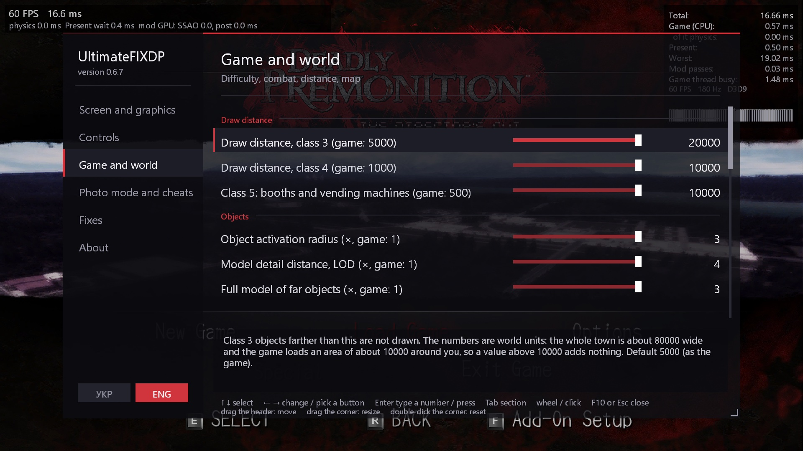
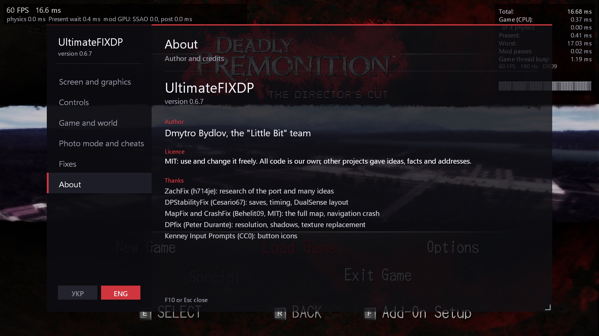

<div align="center">


# UltimateFIXDP

**The all-in-one fix for _Deadly Premonition: The Director's Cut_**
<br>
_Універсальний фікс для_ **Deadly Premonition: The Director's Cut**

[](https://github.com/LittleBitUA/UltimateFIXDP/releases)
[](LICENSE)
[](https://store.steampowered.com/app/247660/)
[](https://t.me/LittleBitUA)


</div>

---

## 🇬🇧 In English

One DLL in the game folder instead of DPfix, a 4 GB patch, a stability fix, a map fix and a crash fix.
No exe patching, no installer: press **F10** in game and everything is there.

> **Public test build.** Most features are tested in game, the rest are marked _experimental_. Back up `savedata\dp.sav` first.

### Features

- 🛡️ **Stability** — the crash after cutscenes, the zero-frame-time freeze and the Alt+Tab hang are fixed; a crash handler and a freeze watchdog write a dump if anything still goes wrong
- 🚀 **Low FPS fixed** — on some PCs the game sat at ~45 FPS with an idle GPU; **45 → 180 FPS** in our test
- ⏱️ **60 FPS limit at any refresh rate** — at 144 / 180 Hz the game used to run too fast
- 🖥️ **Real output resolution** — the picture and the HUD at your monitor's resolution instead of 1280×720, borderless window, no DPI blur
- ✨ **Graphics** — supersampling 1×–3×, SSAO, FXAA, sharpening, wet reflections, 16× anisotropic filtering, sharper shadows, longer draw distance
- 🎮 **DualSense** — USB and Bluetooth without Steam Input, **adaptive triggers per weapon**, haptics for driving and shooting, PlayStation button icons
- 📳 **Rumble that works** — the PC port calculated vibration and never sent it to the gamepad
- 🔫 **Aim on L2, shoot on R2** — like a modern shooter, on Xbox pads too; prompts switch between keyboard and gamepad by themselves
- 🗺️ **Full pause map** — all 64 tiles, proper zoom, north up
- 📍 **Waypoints** — F7 sets a mark; the distance in the game's own font and the game's own arrows on the minimap (_arrows are experimental_)
- 💾 **Safe saves** — atomic writes, backups, automatic restore of a damaged `dp.sav`
- 📷 **Photo mode** — free camera, frozen time, filters, FOV, costumes, poses, PNG screenshots (_experimental_)
- 🧰 **Tools** — frame statistics panel, built-in profiler, cheats page (money, time, weather, ammo, god mode)
- 🇺🇦🇬🇧 **Two languages** — Ukrainian and English, switched in the menu

### Engine fixes (RE-based)

Every fix below comes from reverse engineering the game and comparing the PC
port with the Xbox 360 original:

- 🕒 **The "only a reboot helps" slowdown** — the game counted time from
  the Windows uptime counter in single-precision x87 floats, so after days
  without a reboot the frame time lost precision. The mod hands the game a
  counter that starts with the game.
- 🎯 **The 45 FPS mystery** — the game asks Windows about a WinMM gamepad on
  every frame, even with none connected, and on some systems that call takes
  milliseconds. Found with the mod's own profiler; the mod now asks twice a
  second.
- 🌗 **Day and night inside buildings** — the port reads the building list
  (`HOUSE_LIST`) with a wrong byte-order key: 64 of its 81 entries were misread, so
  interiors had the wrong lighting.
- 💥 **The crash after cutscenes** — an NPC told to walk to waypoint `-1`
  read the navigation table out of bounds. Guarded at the lookup.
- ➗ **The zero-delta freeze** — a frame with zero time divided by zero and
  spun forever. Guarded.
- 🎚️ **Difficulty** — the PC port skips the difficulty screen and stays on
  Easy forever. Normal is the default again, and the choice is yours.
- 📳 **Vibration** — the same event-to-rumble table as on Xbox 360, but the
  PC port never sends it to the device. Restored.
- 🚧 **Draw distance** — booths and vending machines vanished 500 units
  away because of a far plane the Xbox version does not have.

### Screenshots

<table>
<tr>
<td></td>
<td></td>
</tr>
<tr>
<td></td>
<td></td>
</tr>
</table>

### Standing on the shoulders of

The code is our own (MIT). The ideas, facts and addresses came from earlier community work:

| Project | Author | What we learned from it |
|---|---|---|
| **[ZachFix](https://github.com/h714je/ZachFix)** | h714je | Research of the port, many ideas |
| **[DPfix](https://github.com/PeterTh/dpfix)** | Peter "Durante" Thoman | Resolution, shadows, texture replacement |
| **[DPStabilityFix](https://github.com/Cesario67/DeadlyPremonitionFix)** | Cesario67 | Saves, timing, DualSense layout |
| **[CrashFix](https://github.com/Behelit09/DeadlyPremonition-CrashFix)** · **[MapFix](https://github.com/Behelit09/Deadly-Premonition-The-Director-s-Cut-MapFix)** · **[FreeCam](https://github.com/Behelit09/DeadlyPremonition-FreeCam)** | Behelit09 | Navigation crash, the full map, free camera |
| **[DPRecomp](https://github.com/LittleBitUA/DPRecomp)** | «Little Bit» | Our Xbox 360 recompilation: the reference the PC port is compared with |
| **[Kenney Input Prompts](https://kenney.nl/assets/input-prompts)** | Kenney | Gamepad button icons (CC0) |
| **[DXVK](https://github.com/doitsujin/dxvk)** | Philip "doitsujin" Rebohle | Optional Vulkan renderer, bundled under its own license |

🧪 **Testers:** **Gold flin** and **Tree Fan**. Thank you for playing the unfinished builds and reporting everything that broke.

### Installation

1. Back up `savedata\dp.sav`
2. Download the latest version from [Releases](https://github.com/LittleBitUA/UltimateFIXDP/releases)
3. Copy `X3DAudio1_7.dll` and the `UltimateFix` folder into the game folder (next to `DP.exe`)
4. Start the game and press **F10**

> **Requirements:** the Steam version 1.01b of the game. Other builds are detected and the mod stays inactive.
> <br>**DualSense:** turn off Steam Input for the game (Properties → Controller).
> <br>**Do not combine** with DPfix, ZachFix or DPStabilityFix: UltimateFIXDP replaces them.
> <br>**Coming from [DP1 Launcher](https://github.com/dplauncher/DP1-Launcher)?** This is its successor: remove DPfix (`d3d9.dll`, `DPfix.ini`) first.

Optional extras in the release: `ufx_laa.exe` (lets the game use 4 GB of memory, `--undo` reverts), `ufx_play.exe` (start without the launcher window; the mod installs it by itself, hold **Shift** for the old launcher), `dxvk\Install_DXVK.bat` (Vulkan renderer, _experimental_).

To uninstall, delete `X3DAudio1_7.dll`.

### Keys

| Key | Action |
|---|---|
| **F10** | Settings menu |
| **F7** | Set a waypoint (on the pause map or in the world) · **Shift+F7** removes it |
| **F6** | Photo mode |
| **F5** / **F4** | Free camera only / hide the HUD in photo mode |
| **F11** | Screenshot (PNG, without the menu) |
| **F9** | Profiler (writes a profile to the log) |

### If something goes wrong

- `UltimateFix\ufx.log` says for every fix whether it is active or skipped, and why
- Every feature can be switched off in F10 or in `UltimateFix.ini`; `[Debug] SafeMode=1` starts with fewer hooks
- Report problems with `ufx.log` and the `crash_*.dmp` / `hang_*.dmp` file, if there is one
- After an update, an old `UltimateFix.ini` keeps old values: delete it to get the new defaults

### Development

```bash
make                                  # build/X3DAudio1_7.dll
make test DPEXE=/path/to/DP.exe       # checks every patch site against a real DP.exe
```

Stack: **freestanding C++17** (mingw-w64 i686, no C runtime; imports only `kernel32`, `user32`, `gdi32`),
a proxy `X3DAudio1_7.dll` that passes audio calls on to the real library and patches the game in memory.
Every patch checks the game's bytes first: if they differ, only that patch switches itself off.

---

## 🇺🇦 Українською

Одна DLL у теці гри замість DPfix, 4GB-патча, фіксу стабільності, фіксу мапи й фіксу вильотів.
Без правок exe, без інсталятора: натисніть **F10** у грі, і все там.

> **Тестова збірка.** Більшість функцій перевірено в грі, решту позначено як _експериментальні_. Спершу зробіть копію `savedata\dp.sav`.

### Можливості

- 🛡️ **Стабільність** — виправлено виліт після катсцен, зависання на нульовому кадрі й зависання після Alt+Tab; обробник вильотів і сторож зависань пишуть дамп, якщо щось усе ж трапиться
- 🚀 **Виправлено низький FPS** — на деяких ПК гра трималась на ~45 FPS при вільній відеокарті; у нашому тесті **45 → 180 FPS**
- ⏱️ **Ліміт 60 FPS на будь-якій частоті екрана** — на 144 / 180 Гц гра раніше бігла надто швидко
- 🖥️ **Справжня вихідна роздільність** — картинка й HUD у роздільності монітора, а не 1280×720, вікно без рамки, без розмиття від масштабування Windows
- ✨ **Графіка** — суперсемплінг 1×–3×, SSAO, FXAA, різкість, мокрі відбиття, анізотропна фільтрація 16×, чіткіші тіні, більша дальність промальовки
- 🎮 **DualSense** — USB і Bluetooth без Steam Input, **адаптивні триґери під кожну зброю**, відгук у машині й при пострілах, іконки кнопок PlayStation
- 📳 **Вібрація, яка працює** — PC-порт рахував її, але не надсилав на ґеймпад
- 🔫 **Приціл на L2, постріл на R2** — як у сучасних шутерах, і на Xbox-падах; підказки самі перемикаються між клавіатурою й ґеймпадом
- 🗺️ **Повна мапа паузи** — усі 64 плитки, нормальний масштаб, північ угорі
- 📍 **Мітки** — F7 ставить мітку; відстань ігровим шрифтом і рідні стрілки гри на мінімапі (_стрілки експериментальні_)
- 💾 **Надійні збереження** — атомарний запис, резервні копії, автоматичне відновлення пошкодженого `dp.sav`
- 📷 **Фоторежим** — вільна камера, зупинка часу, фільтри, кут огляду, костюми, пози, знімки PNG (_експериментально_)
- 🧰 **Інструменти** — панель статистики кадру, вбудований профайлер, сторінка читкодів (гроші, час, погода, набої, невразливість)
- 🇺🇦🇬🇧 **Дві мови** — українська та англійська, перемикаються в меню

### Виправлення рушія (на основі reverse engineering)

Кожне виправлення нижче — результат розбору коду гри й порівняння PC-порту
з оригіналом для Xbox 360:

- 🕒 **Гальмування, яке лікувалось лише перезавантаженням ПК** — гра
  рахувала час від лічильника роботи Windows у x87 float одинарної точності,
  тож після кількох днів без перезавантаження час кадру втрачав точність.
  Мод дає грі лічильник, який починається разом із нею.
- 🎯 **Загадка 45 FPS** — гра щокадру питає Windows про ґеймпад WinMM,
  навіть коли його немає, а на деяких системах цей виклик триває мілісекунди.
  Знайдено вбудованим профайлером мода; тепер мод питає двічі на секунду.
- 🌗 **День і ніч у будівлях** — порт читає список будівель (`HOUSE_LIST`)
  з неправильним ключем порядку байтів: 64 з 81 записів читались хибно, тож
  у приміщеннях було не те освітлення.
- 💥 **Виліт після катсцен** — NPC, якого відправили до точки `-1`, читав
  таблицю навігації поза її межами. Тепер там стоїть перевірка.
- ➗ **Зависання на нульовому кадрі** — кадр із нульовим часом ділив на нуль
  і крутився вічно. Тепер там стоїть перевірка.
- 🎚️ **Складність** — PC-порт пропускає екран вибору складності й назавжди
  лишає легку. Звичайна знову типова, і вибір за вами.
- 📳 **Вібрація** — та сама таблиця «подія → вібрація», що й на Xbox 360,
  але PC-порт не надсилає її на пристрій. Відновлено.
- 🚧 **Дальність промальовки** — будки й автомати зникали за 500 одиниць
  через дальню площину, якої у версії для Xbox немає.

### На чиїх плечах стоїмо

Код наш власний (MIT). Ідеї, факти й адреси взято з попередніх робіт спільноти:

| Проєкт | Автор | Чого ми з нього навчились |
|---|---|---|
| **[ZachFix](https://github.com/h714je/ZachFix)** | h714je | Дослідження порту, багато ідей |
| **[DPfix](https://github.com/PeterTh/dpfix)** | Peter «Durante» Thoman | Роздільність, тіні, підміна текстур |
| **[DPStabilityFix](https://github.com/Cesario67/DeadlyPremonitionFix)** | Cesario67 | Збереження, час, розкладка DualSense |
| **[CrashFix](https://github.com/Behelit09/DeadlyPremonition-CrashFix)** · **[MapFix](https://github.com/Behelit09/Deadly-Premonition-The-Director-s-Cut-MapFix)** · **[FreeCam](https://github.com/Behelit09/DeadlyPremonition-FreeCam)** | Behelit09 | Виліт навігації, повна мапа, вільна камера |
| **[DPRecomp](https://github.com/LittleBitUA/DPRecomp)** | «Little Bit» | Наша рекомпіляція версії для Xbox 360: еталон, з яким порівнюємо PC-порт |
| **[Kenney Input Prompts](https://kenney.nl/assets/input-prompts)** | Kenney | Іконки кнопок ґеймпада (CC0) |
| **[DXVK](https://github.com/doitsujin/dxvk)** | Philip «doitsujin» Rebohle | Необов'язковий Vulkan-рендерер, під власною ліцензією |

🧪 **Тестувальники:** **Gold flin** і **Tree Fan**. Дякуємо, що грали в недороблені збірки й повідомляли про все, що ламалось.

### Встановлення

1. Зробіть копію `savedata\dp.sav`
2. Завантажте останню версію з [Releases](https://github.com/LittleBitUA/UltimateFIXDP/releases)
3. Скопіюйте `X3DAudio1_7.dll` і теку `UltimateFix` у теку гри (поруч із `DP.exe`)
4. Запустіть гру й натисніть **F10**

> **Вимоги:** Steam-версія гри 1.01b. Інші збірки мод розпізнає і не вмикається.
> <br>**DualSense:** вимкніть Steam Input для гри (Властивості → Контролер).
> <br>**Не поєднуйте** з DPfix, ZachFix і DPStabilityFix: UltimateFIXDP їх замінює.
> <br>**Користувались [DP1 Launcher](https://github.com/dplauncher/DP1-Launcher)?** Це його наступник: спершу приберіть DPfix (`d3d9.dll`, `DPfix.ini`).

Необов'язкові додатки в релізі: `ufx_laa.exe` (дозволяє грі 4 ГБ пам'яті, `--undo` повертає як було), `ufx_play.exe` (запуск без вікна лаунчера; мод ставить його сам, утримуйте **Shift**, щоб відкрити старий лаунчер), `dxvk\Install_DXVK.bat` (Vulkan-рендерер, _експериментально_).

Щоб видалити мод, видаліть `X3DAudio1_7.dll`.

### Клавіші

| Клавіша | Дія |
|---|---|
| **F10** | Меню налаштувань |
| **F7** | Поставити мітку (на мапі паузи або у світі) · **Shift+F7** прибирає |
| **F6** | Фоторежим |
| **F5** / **F4** | Лише вільна камера / сховати HUD у фоторежимі |
| **F11** | Знімок екрана (PNG, без меню) |
| **F9** | Профайлер (пише профіль у журнал) |

### Якщо щось не так

- `UltimateFix\ufx.log` пише про кожне виправлення, чи воно ввімкнене, чи пропущене, і чому
- Будь-яку функцію можна вимкнути в F10 або в `UltimateFix.ini`; `[Debug] SafeMode=1` запускає мод із меншою кількістю хуків
- Про проблеми пишіть із файлом `ufx.log` і файлом `crash_*.dmp` / `hang_*.dmp`, якщо він є
- Після оновлення старий `UltimateFix.ini` зберігає старі значення: видаліть його, щоб отримати нові типові

### Розробка

```bash
make                                  # build/X3DAudio1_7.dll
make test DPEXE=/шлях/до/DP.exe       # звіряє кожне місце правки зі справжнім DP.exe
```

Стек: **C++17 без C runtime** (mingw-w64 i686; імпорти лише `kernel32`, `user32`, `gdi32`),
підмінний `X3DAudio1_7.dll`, який передає звукові виклики справжній бібліотеці й виправляє гру в пам'яті.
Кожна правка спершу звіряє байти гри: якщо вони інші, вимикається лише ця правка.

---

## ⚖️ Disclaimer

Цей проєкт не афілійований із Access Games / Rising Star Games / Toybox Inc.
Усі права на гру належать правовласникам. Проєкт не містить файлів гри.
Це фанатська ініціатива, безкоштовно і з відкритою душею.

This project is not affiliated with Access Games / Rising Star Games / Toybox Inc.
All rights to the game belong to their respective owners. The project ships no game files.
This is a fan-made, free, open initiative.

---

<div align="center">

Створено **Dmytro Bidlov** з любов'ю від [«Little Bit»](https://t.me/LittleBitUA) 🇺🇦
&nbsp;·&nbsp;
Made by **Dmytro Bidlov** with love from [«Little Bit»](https://t.me/LittleBitUA) 🇺🇦

Спасибі Swery (Hidetaka Suehiro) за безсмертну, абсурдну й щемливу гру. ✦

</div>
